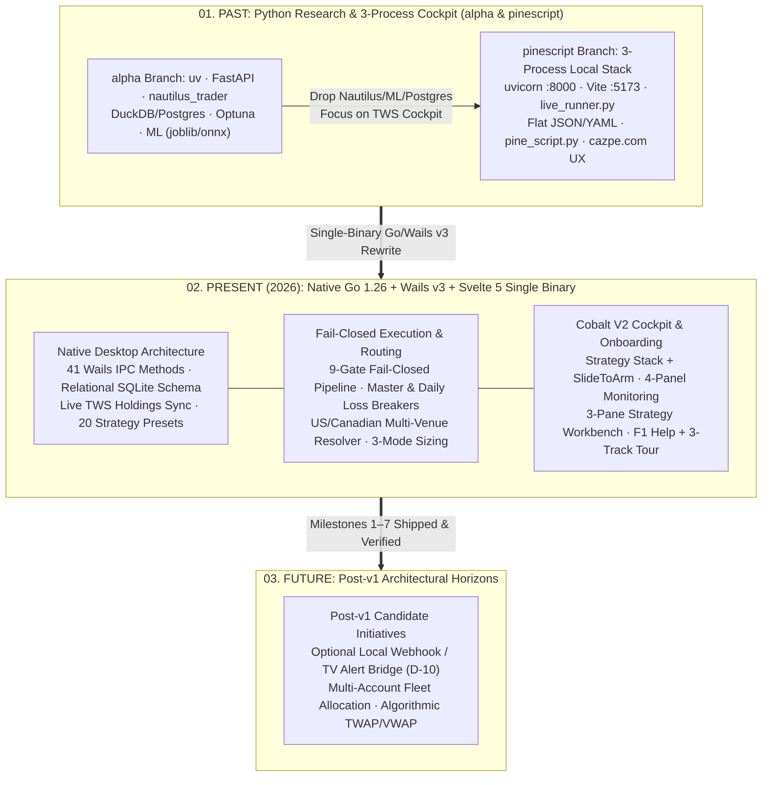

# `tws_traderbot` Operational Knowledge Framework (`okf`) — Master Manifest & Executive Summary

**System:** `tws_traderbot` — Local Interactive Brokers (TWS) Trading Workstation & Cobalt Methodology Cockpit  
**Engineering Stack:** Go `1.26` · Wails v3 (`v3.1.0`) · Svelte 5 (`runes: false`) · `scmhub/ibapi` (`v0.10.50`) · SQLite (`modernc.org/sqlite`)  
**Broker Interface:** Interactive Brokers TWS / IB Gateway (`127.0.0.1:7497`, Socket API)  
**Canonical Repository Path:** `okf/` (in-tree at root of `Boostao/tws_tradingbot`, branch `wails3` `HEAD`)  
**Audit Baseline Date:** `2026-11-17` (Cobalt V2 Overhaul Shipped & Verified)  

---

## 1. Executive Summary

`tws_traderbot` is a local desktop trading workstation connecting **TradingView shared watchlists** and **Cobalt Investissements rule methodologies** to **Interactive Brokers Trader Workstation (TWS)** on the trader's own hardware—designed for a "vibe trader" operating model where broad curated lists (120–687+ symbols) funnel down (`REGARD MATINAL` `3–4` pre-market focus tickers $\rightarrow$ `1–3` active trades/session) with instant, non-destructive on/off controls.

Synthesizing forensic evidence across **all four git branches (`alpha`, `pinescript`, `main`, `wails3`)**, **Go/Svelte source files (`HEAD`)**, **local SQLite runtime state**, **Telegram coordination logs (`messages.html` `#1`–`#120+`, `10` screenshots, `2026-04-28` meeting summary, `12:16` client video walkthrough & `37` key frames)**, **three live TradingView shared feeds (`209453826` `687` symbols, `111426240` `123` symbols, `40576813` `54` regime symbols)**, and **authenticated `cobaltinvestissements.com` extractions** (`2025-11-17_Methode_de_travail_8_8.pdf`, `473` `/mon-compte/analyse` daily brief entries, `36` Vimeo course videos across `34` VTT + `2` Whisper transcripts, `14` targeted keyframes, `13` Lesson `213` TradingView styles, `Lesson 212` `MODÈLE ANALYSE`, `Screener 2.0`, `COBALT Ratios | PRO`, `Cours-01..06`, and `57`-module `trader_ibkr` curriculum), this framework establishes the unified Past, Present, and Future record:

1. **The Past (`alpha` & `pinescript` Python Eras):** Originating on the `alpha` branch as a multi-service Python research stack (`uv`, FastAPI, `nautilus_trader`, DuckDB/PostgreSQL, Optuna, `joblib`/`onnxruntime` ML signals), `tws_traderbot` pivoted on the `pinescript` branch to a 3-process local TWS cockpit (`uvicorn :8000`, SvelteKit `:5173`, `live_runner.py`, flat JSON/YAML configs, `pine_script.py`, `TWSDataWrapper` on port `7497`) shaped around the `cazpe.com` prototype (`Achat` / `Short` / `Swing` tabs, grouped TradingView imports, Main Breaker, and buy-first / manual-exit operation) ([Legacy & Migration](./01_history_and_evolution/legacy_and_migration.md)).
2. **The Present (`2026` — `wails3` Native Go Desktop `HEAD` + Cobalt V2 Baseline):**
   - **Native Desktop Architecture (`wails3` `HEAD`):** Written in Go `1.26` and Wails v3 (`ApplicationID: ca.boostao.tws_traderbot`, Linux `.desktop`/`hicolor` packaging), exposing **41 Wails v3 IPC methods** (`frontend/bindings/tws_traderbot/app.js`; 42 Go `*App` methods including `ServiceStartup`), pure-Go `modernc.org/sqlite` relational persistence (`watchlists`, `watchlist_items`, `strategies` with `pinned`/`sort_order`, `trade_ledger`, `system_config`), race-hardened `scmhub/ibapi` (`third_party/ibapi` `v0.10.50` + `IBWrapper` live `AccountSummary`, `UpdateAccountValue`, `Position`, `UpdatePortfolio`, `OpenOrder`, `OrderStatus`, `Pnl`, and `BuildBrokerAlert`), dynamic `positions-detenues` sync (`SyncLivePositions` from live `pos != 0` holdings, zero seeded `AAPL`/`SHOP`), multi-timeframe bar bundles (`barframe.go`) across all 9 Cobalt intervals, memoized indicator pipeline (22 `IndicatorType` definitions), TradingView HTML `init-data` scraping (`ImportTradingViewWatchlist`), and bilingual (`en`/`fr`) Svelte 5 views (`/cockpit` with pinned/reorderable Strategy Stack + `>= 78%` `SlideToArm`, `/watchlist`, 3-pane `/strategy` workbench, 4-panel `/monitoring`, `/manual`, `F1`/`?` `HelpDrawer`, 3-track `OnboardingTour`, collapsible `Sidebar`, and Cobalt brand system) with 100% key parity ([System Architecture](./02_present_state/system_architecture.md), [Cobalt Brand & UI Guide](./02_present_state/cobalt_brand_and_ui_guide.md), [Engineering Playbook](./05_engineering_and_agents/engineering_playbook.md)).
   - **Cobalt Domain, Daily Cadence & Universe Baseline:** Captures `REGARD MATINAL` (`228` daily briefs narrowing to `3–4` focus stocks), `Méthode de travail 8.8` (`A -> A -> A`, 12 analysis + 5 execution steps, `1-Blue Chip / 2-Croissance / 3-Spéculatif / 4-Rejeté`, `($$$$)` owned list), `CANAL-Cobalt` (`CobaltAdmin_bot`, `09:00–13:30` transport), `✝️@ Cobalt- TELEGRAM` (`209453826`, `687` symbols / `16` prefixes), `⚾️@ Cobalt- Home Run` (`111426240`, `123` symbols / `7` prefixes), `CBLT - MARCHÉS` (`40576813`, `54` macro/regime benchmarks), per-ticker 3-mode sizing (`# shares` > `$` > `% portfolio`), suspend-without-deleting toggles, all **13 Lesson `213` templates**, **19-row `COBALT Ratios | PRO` (`v1.23`->`v1.33`)**, and **4 official `Screener 2.0` presets** ([Cobalt Trading Universe](./02_present_state/cobalt_trading_universe.md), [Cobalt Indicators & Courses](./02_present_state/cobalt_indicators_and_courses.md)).
   - **Hardened Delivery & Gap Closure:** All legacy HTTP `/api/v1/*` stubs and `(window as any).go` guards completely eliminated in favor of strongly-typed Wails v3 IPC; `Engine` fully wired to 9-gate fail-closed pipeline with Coupe-circuit principal and daily loss risk breaker; 3-mode position sizing (`# shares`, `$ notional`, `% portfolio`) fully operational; multi-venue contract resolver handling US (`SMART/USD`), Canadian (`SMART/CAD` TSE/VENTURE/PURE), dot-class normalizations (`BRK B`, `CTC A`), and regime-reference filtering; 9 Cobalt timeframes and memoized indicator pipeline (11+ indicators) active; 20 Cobalt presets pre-seeded in SQLite; and strict dry-run ledger recording enforced ([Capability Matrix](./02_present_state/capability_matrix.md), [Decisions & Gaps](./04_evidence_and_sources/decisions_and_gaps.md)).
3. **The Future (Post-v1 Evolutionary Horizons):** Phases 0–4 of the original rebuild roadmap have been fully delivered and verified in Milestone 7. The future architecture horizon shifts to post-v1 candidate enhancements: optional local TradingView alert/webhook receiver (`D-10`), multi-account fleet management, and advanced order algorithms (trailing stop-limit, volume-paced TWAP/VWAP) ([Future Roadmap](./03_future_architecture/roadmap.md)).

---

## 2. Past $\rightarrow$ Present $\rightarrow$ Future Architectural Trajectory



---

## 3. Repository Directory Structure & Complete Document Manifest

```text
okf/
├── AGENTS.md                                      # Self-curating okf/ memory & synchronization protocol
├── 00_index.md                                    # Master manifest, trajectory diagram & glossary (this file)
├── 01_history_and_evolution/
│   └── legacy_and_migration.md                    # Evolution: alpha/pinescript Python -> Go/Wails v2 -> Wails v3 HEAD
├── 02_present_state/
│   ├── system_architecture.md                     # Living wails3 architecture: Wails IPC, SQLite, Bot Engine, Strategy & Svelte 5
│   ├── capability_matrix.md                       # Feature parity audit: Implemented & Tested vs. Stubbed vs. Missing
│   ├── cobalt_trading_universe.md                 # Vibe-trader funnel, Method 8.8, 473 daily briefs, TV feeds (209453826/111426240/40576813) & sizing
│   ├── cobalt_indicators_and_courses.md           # 13 Cobalt TradingView styles, Method 8.8, COBALT Ratios PRO, Screener 2.0, Cours-01..06 & TWS syllabus
│   └── cobalt_brand_and_ui_guide.md               # Canonical Cobalt brand tokens, offline typography, density/<select> contracts, emblems & Wayland AppID
├── 03_future_architecture/
│   └── roadmap.md                                 # 5-phase rebuild/bootstrap plan closing Go/UI/Cobalt gaps
├── 04_evidence_and_sources/
│   ├── citations_index.md                         # Redacted catalog of Telegram logs, Method 8.8 PDF, 36 transcripts, 14 keyframes & 473 briefs
│   └── decisions_and_gaps.md                      # Numbered D-01..D-18 architecture decisions, safety/telemetry invariants & open confirmations
└── 05_engineering_and_agents/
    └── engineering_playbook.md                    # Go, Wails v3, modernc.org/sqlite, scmhub/ibapi, Svelte 5 & i18n rules
```

| Module | Document Link | Core Contents & Key Takeaways |
|---|---|---|
| **`00`** | **[Master Index](./00_index.md)** · **[`okf/AGENTS.md`](./AGENTS.md)** | Executive synthesis, Past $\rightarrow$ Present $\rightarrow$ Future diagram, canonical glossary, and self-curating `okf/` hygiene rules. |
| **`01.1`** | **[Legacy & Migration](./01_history_and_evolution/legacy_and_migration.md)** | 4-era evolution (`alpha` Nautilus/DuckDB $\rightarrow$ `pinescript` 3-process cockpit $\rightarrow$ `main` Go/Wails v2 $\rightarrow$ `wails3` v3 `22beb38`). |
| **`02.1`** | **[System Architecture](./02_present_state/system_architecture.md)** | Complete `wails3` `HEAD` topology: `41` Wails IPC methods (`42` Go `*App` methods), relational SQLite (`watchlists`, `strategies` with `pinned`/`sort_order`), live TWS `IBWrapper` telemetry, `Engine`/`barframe`, Cobalt V2 Svelte 5 UI & Wayland packaging. |
| **`02.2`** | **[Capability Matrix](./02_present_state/capability_matrix.md)** | Feature-by-feature audit covering Wails v3 IPC (`41` bindings), SQLite & `SyncLivePositions`, pinned/ordered Strategy Stack + `SlideToArm`, 4-panel `/monitoring`, 3-pane `/strategy`, `HelpDrawer` + `OnboardingTour`, and live TWS telemetry. |
| **`02.3`** | **[Cobalt Trading Universe](./02_present_state/cobalt_trading_universe.md)** | Vibe-trader funnel (`120–687` $\rightarrow$ `1–3` trades), `REGARD MATINAL` (`473` archive), `Méthode 8.8`, `CANAL-Cobalt`, `209453826`/`111426240`/`40576813` breakdowns, **8 collisions**, 3-mode sizing. |
| **`02.4`** | **[Cobalt Indicators & Courses](./02_present_state/cobalt_indicators_and_courses.md)** | All **13 Lesson `213` templates**, `Méthode 8.8`, `19`-row `COBALT Ratios | PRO` (`v1.23`/`v1.33`), **4 `Screener 2.0` presets**, `MODÈLE ANALYSE`, `Cours-01..06`, `57`-item TWS syllabus, Go gap map. |
| **`02.5`** | **[Cobalt Brand & UI Guide](./02_present_state/cobalt_brand_and_ui_guide.md)** | Canonical Cobalt brand tokens (`cobaltinvestissements.com` × `Uni Noir`), offline typography scale, density/`<select>` contracts, Two-Tier emblem specs & Wayland AppID packaging. |
| **`03.1`** | **[Rebuild & Bootstrap Roadmap](./03_future_architecture/roadmap.md)** | Shipped Phases `0`–`4` + Cobalt V2 overhaul (`Achat`/`Short`/`Swing`, live TWS telemetry, Strategy Stack, 4-panel Monitoring, 3-pane Workbench, Brand/Onboarding) and post-v1 horizons. |
| **`04.1`** | **[Citations Index](./04_evidence_and_sources/citations_index.md)** | Privacy-redacted inventory of Telegram logs/photos, `Méthode 8.8` PDF, `36` course video transcripts, `14` keyframes, `473` daily briefs, SQLite snapshots, git branches, and web URLs. |
| **`04.2`** | **[Decisions & Gaps](./04_evidence_and_sources/decisions_and_gaps.md)** | Numbered **`D-01`–`D-18`** register tracking settled local-TWS/Go/Cobalt V2 decisions, safety/telemetry invariants, and open client confirmations. |
| **`05.1`** | **[Engineering Playbook](./05_engineering_and_agents/engineering_playbook.md)** | Actionable rules for Wails v3 bindings, `modernc.org/sqlite`, `scmhub/ibapi` error suppression & pacing, Svelte 5 (`runes: false`), `en`/`fr` i18n, and test gates. |

---

## 4. Canonical Domain & Execution Taxonomy

| Term / Concept | Canonical Definition |
|---|---|
| **Vibe Trader Workflow** | Hybrid discretionary/systematic execution model: start from broad curated TradingView watchlists (`120–687` symbols), triage daily pre-market focus (`REGARD MATINAL` `3–4` tickers), apply strict multi-rule filters to fire on `1–3` setups per session, and retain fast manual cockpit overrides. |
| **`Méthode de travail 8.8` (`A -> A -> A`)** | Official Cobalt cycle (`Analyse – Alarme – Action`): 12 analysis steps classifying tickers into **`1-Blue Chip`**, **`2-Croissance`**, **`3-Spéculatif`**, or **`4-Rejeté`** (`M/W -> D -> 30m..1m`), plus 5 execution steps tracking owned holdings in **`($$$$)`**. |
| **Main Breaker (`Coupe-circuit principal`)** | Top-level `global_enabled` switch in `CockpitStateResponse` intended to pause all automated order routing across every workspace instantaneously without erasing watchlists or strategy bindings. |
| **Workspaces (`Achat`, `Short`, `Swing`)** | Three operational cockpit tabs separating long intraday/momentum (`Achat`), short-selling (`Short`), and swing (`Swing`) configurations, each with workspace enablement and strategy slot(s). |
| **Suspend Without Deleting** | Core UI/engine requirement: toggling a watchlist group or individual ticker `OFF` suppresses order triggers for that symbol (e.g., during news/earnings) while preserving its watchlist membership, sizing config, and market-data feed. |
| **TradingView Shared Feeds & `CANAL-Cobalt`** | Public TradingView watchlist URLs (`209453826` `✝️@ Cobalt- TELEGRAM`, `111426240` `⚾️@ Cobalt- Home Run`, `40576813` `CBLT - MARCHÉS`) parsed via `application/prs.init-data+json`; Telegram (`Cobalt Plateforme` / `CANAL-Cobalt` via `CobaltAdmin_bot` `09:00–13:30`) acts strictly as distribution transport. |
| **`instrument_id` (`SYMBOL.VENUE`) & `regime_reference`** | Canonical venue-qualified identifier preventing the **8 exchange-stripped collisions** in `209453826`, paired with `regime_reference` tagging so macro/yield/FX/TSX-index feeds (`40576813`, `TVC:VIX`) inform filters without placing orders. |
| **3-Mode Position Sizing (`#` / `$` / `%`)** | Per-ticker sizing modes requested by `Trader / Client`: **`# shares`** (fixed share count, top priority), **`$`** (fixed dollar notional converted to shares), and **`%`** (percentage of portfolio equity). |
| **Buy-First / Manual-Exit Scope** | Release 1 automation policy prioritizing automated entry (`BUY`) execution while position exits are handled manually in TWS (or optionally protected by `stop_loss_pct` / `take_profit_pct` brackets). |
| **13 Cobalt Chart Styles (`Lesson 213`)** | Standardized TradingView indicator templates (`1`, `2`, `3`, `3G`, `3T`, `4`, `4E`, `5`, `6`, `7`, `8`, `9`, `F`) spanning `SMA`, `EMA`, `Volume+MA100`, `OBV`, `MACD`, `RSI`, `Stochastic`, `Bollinger`, `Alligator`, `Guppy`, `Ticker/SPX`, `P/E`, `Div%`, and `COBALT Ratios`. |
| **Weinstein Phases & `SRT`** | Technical curriculum framework (`Cours-01..06`) combining manual Supports/Resistances/Trends (`SRT`) with Weinstein Phase 1–4 cycle staging on Monthly (`M`), Weekly (`W`), and Daily (`D`) bars. |
| **`RTH` vs. `ETH`** | Regular Trading Hours (`09:30–16:00 ET`) vs. Extended Trading Hours (pre/post-market session settings differentiated on intraday charts `< 1D` in `Lesson 212`; `MKT` orders fail outside RTH per `Lesson 224`). |
| **Dry-Run Preflight** | Non-executing validation mode surfacing planned subscriptions, candidate orders, and rule evaluation logs in `/monitoring` without calling IBKR `PlaceOrder`. |
