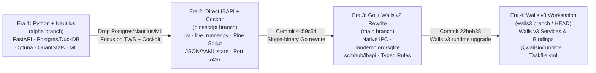

# Legacy Evolution & Migration to Go + Wails v3 (`01_history_and_evolution`)

> **Navigation:** [Master Index](../00_index.md) | **Related:** [System Architecture](../02_present_state/system_architecture.md) · [Capability Matrix](../02_present_state/capability_matrix.md) · [Engineering Playbook](../05_engineering_and_agents/engineering_playbook.md)  
> **Status:** `Active`

---

## 1. Migration Trajectory Overview

`tws_traderbot` evolved across four distinct architectural phases—from a multi-service Python/Nautilus/ML research stack into a single-binary native desktop workstation built on **Go `1.26`**, **Wails v3**, **Svelte 5**, **`modernc.org/sqlite`**, and **`scmhub/ibapi`**.

---

## 2. Historical Eras

### Era 1: Python Research & Multi-Service Stack (`alpha` branch)

The earliest architecture (`alpha` branch) combined algorithmic backtesting, parameter optimization, and live execution across containerized/local Python and Node services:

- **Dependency & Environment Management:** Python `>=3.11` managed with `uv` (`pyproject.toml`, `uv.lock`).
- **Execution & Backtest Core:** `nautilus_trader` (`>=1.180.0`) paired with `nautilus_ibapi==10.30.1`, plus Optuna (`src/bot/optimizer.py`), QuantStats tear sheets, and Plotly charts.
- **ML Signal Pipeline (`src/utils/ml_models.py`):** Optional `joblib` and `onnxruntime` inference (`predict_signal_series`), caching loaded models via `functools.lru_cache` and feeding `"ml_signal"` strategy indicators.
- **Database Churn (DuckDB $\leftrightarrow$ PostgreSQL):** Early commits stored state in DuckDB (`data/traderbot.duckdb`), temporarily introduced PostgreSQL (`psycopg` / `psycopg_pool` via `docker-compose.yml`), and later reverted back to embedded **DuckDB** (`commit 86290dd`, *"drop postgres backend"*) in `src/config/database.py`.
- **Control Plane & Deployment:** FastAPI (`src/api/main.py`) with WebSocket router (`src/api/routers/ws.py`), Docker Compose (`docker-compose.yml`, `docker-compose.prod.yml`), Caddy (`deploy/Caddyfile`), and IBC headless gateway scripts (`deploy/ibc-run-ibc.sh`).

### Era 2: Direct `ibapi`, Pine Script & Cockpit UX (`pinescript` branch)

Operational feedback from the Trader / Client ([`NOTES.md`](../../../NOTES.md)) reshaped the product around a day-to-day execution cockpit rather than an ML research harness:

- **Simplified 3-Process Local Stack ([`TWS_SETUP_GUIDE.md`](../../../TWS_SETUP_GUIDE.md)):**
  1. `./run_api.sh` $\rightarrow$ `uvicorn src.api.main:app --host 0.0.0.0 --port 8000`
  2. `./run_web.sh` $\rightarrow$ SvelteKit dev server on `http://localhost:5173`
  3. `./run_bot.sh` $\rightarrow$ `python -m src.bot.live_runner` connecting to local TWS Paper Trading on `127.0.0.1:7497` (`client_id: 1`).
- **Flat-File Persistence:** Replaced DuckDB with atomic JSON/YAML files (`config/default.yaml`, `config/cockpit.json`, `config/watchlist.json`, `config/watchlist.txt`, `config/active_strategy.json`, `config/.bot_state.json`, `config/.bot_ledger.json`).
- **Direct Python `ibapi` (`src/bot/tws_data_provider.py`, `src/bot/live_runner.py`):**
  - `TWSDataWrapper(EWrapper)` and `TWSDataProvider` managed thread-safe historical bar requests, account snapshots, open orders, portfolio positions, and permission/informational error filtering (`2100`, `2104`, `2106`, `2119`, `2158`, `2174`, `10089`).
  - `LiveTradingRunner` normalized tickers to `SYMBOL.VENUE` (`src/bot/instruments.py`), subscribed to full watchlist market-data universes, evaluated multi-timeframe `symbol -> timeframe -> DataFrame` bundles (`src/bot/strategy/rules/market_data.py`), and executed via `StrategyExecutionPlanner` (`src/bot/execution.py`) using `fixed_notional` sizing and optional stop-loss / take-profit brackets.
- **Pine Script Generator (`src/bot/strategy/pine_script.py`):** Compiled rule JSON definitions into TradingView Pine Script strings (`GET /api/v1/strategy/pine-script`).
- **Cockpit Model (`config/cockpit.json`):** Established three operational tabs—**`Achat`** (`kind: "long"`), **`Short`** (`kind: "short"`), and **`Swing`** (`kind: "swing"`)—enforcing one active strategy slot per workspace alongside grouped TradingView shared-watchlist imports and a global main breaker (`global_enabled`).

### Era 3: Native Go + Wails v2 Desktop Rewrite (`main` branch)

To eliminate Python virtual environments (`uv`), multi-terminal startup scripts, and FastAPI HTTP overhead on user hardware, [`MIGRATION_PLAN_GO_WAILS.md`](../../../MIGRATION_PLAN_GO_WAILS.md) guided a full native rewrite landed in commit `4c59c54`:

- **Planned vs. Realized Go Stack Adjustments:**
  - *Database:* Adopted pure-Go **`modernc.org/sqlite`** (`tws_traderbot.sqlite`) as planned—zero CGO required for database compilation, storing document JSON payloads (`watchlist_state`, `cockpit_state`, `strategy`, `config`, `tws_connection`) inside `system_config`.
  - *IBKR Driver:* Selected **`github.com/scmhub/ibapi`** (`v0.10.46`) rather than `hadrianl/ibapi`, embedding `ibapi.Wrapper` inside `IBWrapper` on TCP `127.0.0.1:7497`.
  - *Technical Indicators & Scope Pruning:* Implemented native slice math directly in `backend/strategy/` (`SMA`, `EMA`, `CrossAbove`, `Slope`) rather than importing `go-talib`; dropped Pine Script generation (`commit 551bc78`) and Python ML runtime (`ml_models.py`).
- **5-Part IPC & Execution Integration (`commits 7c2279e`–`414aada`, `7bc8f9f`, `732fbd4`):**
  - Replaced file/HTTP persistence with Wails IPC methods (`GetConfig`, `UpdateConfig`, `GetStrategy`, `UpdateStrategy`, `GetTWSConnection`, `UpdateTWSConnection`, `ImportStrategyFile`, `ExportStrategyFile`).
  - Added Wails runtime event emissions (`pulse_tick`, `matrix_update`, `ledger_entry`) inside `Engine.EvaluateTick()` and `IBWrapper.ExecuteAction()`.
  - Overrode `IBWrapper.Error` to suppress noisy TWS data-farm informational codes (`2104`, `2106`, `2158`).

### Era 4: Wails v3 Upgrade (`wails3` branch, `HEAD` `22beb38`)

Commit `22beb38` upgraded the desktop host runtime to **Wails v3** (`github.com/wailsapp/wails/v3 v3.0.0-alpha.96`) on Go `1.26`:

- **Application & Service Lifecycle:** [`main.go`](../../main.go) switched to `application.New(application.Options{...})`, `app.RegisterService(application.NewService(svc))`, and `application.NewWindow(...)`. [`app.go`](../../app.go) replaced Wails v2 `startup(ctx)` with `ServiceStartup(ctx context.Context, options application.ServiceOptions)`.
- **Build Tooling:** Replaced Wails v2 CLI expectations with [`Taskfile.yml`](../../Taskfile.yml) and [`build/config.yml`](../../build/config.yml) (`wails3 dev`, `wails3 generate bindings`, `task build`).
- **Frontend Binding Shift:** Generated Wails v3 service stubs under [`frontend/bindings/tws_traderbot/app.js`](../../frontend/bindings/tws_traderbot/app.js) using `@wailsio/runtime` (`$Call.ByID`, `Events.On` / `Events.Off`), superseding the legacy `frontend/wailsjs/` directory.

---

## 3. Legacy Python vs. Current Go/Wails v3 Comparison

| Dimension | Legacy Python (`pinescript` / `alpha`) | Current Native (`wails3` `HEAD`) |
|---|---|---|
| **Runtime Topology** | 3 local processes (`uvicorn :8000`, `vite :5173`, `live_runner.py`) | Single native desktop binary (`bin/tws_traderbot`) embedding `frontend/dist` |
| **Package / Dependency Tooling** | `uv` + `pyproject.toml` + `npm` | `go 1.26` ([`go.mod`](../../go.mod)) + [`Taskfile.yml`](../../Taskfile.yml) + `wails3` + `npm` |
| **UI <-> Backend Transport** | HTTP REST (`GET/PUT /api/v1/*`) + WebSocket (`alpha`) | Wails v3 `$Call.ByID` IPC bindings + `@wailsio/runtime` events |
| **State Storage** | DuckDB / PostgreSQL (`alpha`) $\rightarrow$ JSON & YAML files (`pinescript`) | Embedded pure-Go SQLite (`modernc.org/sqlite`) `system_config` table |
| **TWS / IBKR Client** | Official Python `ibapi` (`TWSDataWrapper`, port `7497`) | Go `github.com/scmhub/ibapi` (`IBWrapper`, port `7497`) |
| **Strategy Evaluation** | Pandas/NumPy `RuleEngine`, `IndicatorFactory`, multi-TF bundles, `ml_models.py`, `pine_script.py` | Typed Go structs + slice math (`SMA`, `EMA`, `CrossAbove`, `Slope`); ML & Pine Script dropped |
| **Execution & Sizing** | `StrategyExecutionPlanner` (`fixed_notional`, SL/TP brackets) | `IBWrapper.ExecuteAction` MKT order stub (see [Capability Matrix](../02_present_state/capability_matrix.md)) |
