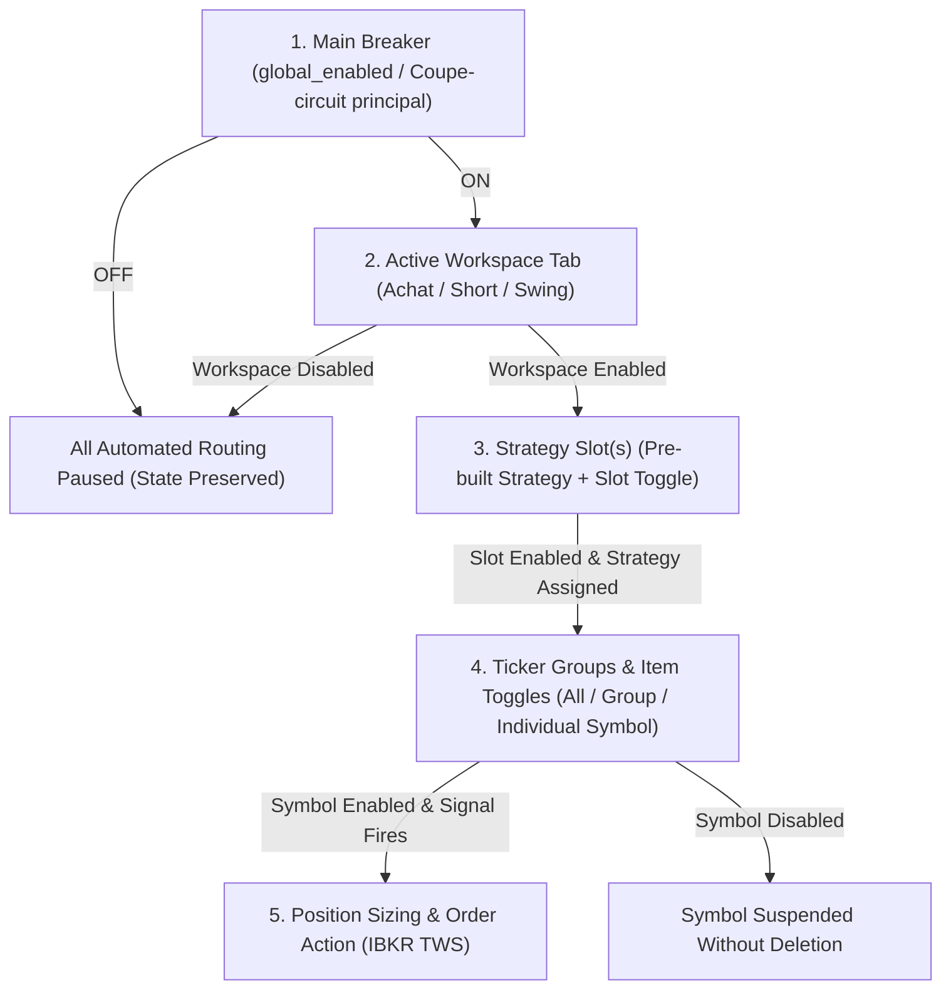

# Cobalt Trading Universe, Watchlists & Execution Model (`02_present_state`)

> **Navigation:** [Master Index](../00_index.md) | **Related:** [Indicators & Courses](./cobalt_indicators_and_courses.md) · [System Architecture](./system_architecture.md) · [Capability Matrix](./capability_matrix.md) · [Citations Index](../04_evidence_and_sources/citations_index.md) · [Decisions & Gaps](../04_evidence_and_sources/decisions_and_gaps.md)  
> **Status:** `Active`

---

## 1. Operational Context & Trader Profile

`tws_traderbot` is engineered for a hybrid discretionary/systematic ("vibe trader") workflow rooted in the Cobalt Investissements methodology and executed locally beside Interactive Brokers Trader Workstation (TWS / IB Gateway on `127.0.0.1:7497`). Based on the April–July 2026 design sessions, Telegram coordination logs, video walkthrough (`bruno 1.mp4` / `bruno 1.m4a`), `Méthode de travail 8.8`, and the `/mon-compte/analyse` daily brief archive, the ecosystem separates **curated list & signal distribution** from **local execution control**:

1. **Local Execution Architecture (No VPS Order Routing for Release 1):** Settled during the 2026-04-28 architecture meeting — the bot runs on the trader's own desktop hardware directly against the local TWS socket API to minimize latency and avoid remote webhook/VPS complexity in initial production.
2. **Two-Tier Ecosystem (Curator vs. Subscriber / Operator):**
   - **Curated Watchlist & Signal Distribution:** `Trader / Client` maintains master watchlists inside TradingView and distributes shared links over Telegram (`Cobalt Plateforme` / `CANAL-Cobalt`). Telegram serves strictly as the **transport channel**, while TradingView shared watchlist URLs act as the canonical symbol source (`NOTES.md`).
   - **Local Execution Cockpit:** Each operator imports the shared TradingView feed into `tws_traderbot`, assigns pre-built reusable strategies, toggles workspaces/strategies/tickers on or off, and monitors execution locally in TWS.
3. **Behavioral "Vibe Trader" Operating Patterns:**
   - **Wide Funnel, Narrow Daily Trigger Set:** The trader curates 120–687+ symbols in master watchlists, yet configures strict multi-rule filters so automated entries trigger on only **1–3 stocks per session** (`bruno 1.m4a`) and narrows daily pre-market focus to **3–4 tickers** (`REGARD MATINAL` -> `Prémarkets – À regarder`).
   - **Suspend Without Deleting:** A foundational UX requirement across `bruno 1.m4a`, `NOTES.md`, and `photo_3`. When intraday conditions or news affect 10 tickers out of 100–500+, the operator toggles those tickers (or a single ticker like `AAPL` for half the session) **OFF** and later back **ON** without deleting them from the list or rebuilding watchlists.
   - **Three-Click Activation & Global Main Breaker:** From a single operational cockpit (`Achat`, `Short`, `Swing`), the operator wants ~3 clicks to select a workspace tab, enable/select a strategy, and toggle target tickers, paired with a global **Main Breaker** (`Coupe-circuit principal`) to halt all order routing across every workspace when stepping away without erasing configurations.
   - **Buy-First / Manual-Exit Release 1 Workflow:** Confirmed in `bruno 1.m4a` and `NOTES.md`. Initial live automation focuses on **automated entry (`BUY`)** while exits remain **manually managed inside TWS**; automated sell rules and optional percentage brackets (`Stop-loss %` / `Take-profit %`) are staged enhancements rather than blockers for initial entry execution.
   - **Human Arming & Compliance Guardrail:** Raised during the 2026-04-28 meeting — maintaining explicit operator-armed toggles (Main Breaker + Workspace + Strategy Slot + Ticker toggles) keeps automated executions subordinate to explicit user activation on local hardware.
   - **Visual Density & Readability:** `Trader / Client` requested larger, high-contrast buttons and typography (`messages.html` `#84`), while `Advisor / Ops` flagged grid scaling/pagination needs when managing 100–500+ tickers across multiple strategies (`messages.html` `#69`: e.g., `25 / 50 / 100 / All` or live text filtering).

### 1.1 Daily Operational Rhythm, Method Funnel & Telegram Transport

- **`/mon-compte/analyse` Daily Brief Cadence (`473` entries, `2025-09-09` to `2026-11-13`):**
  - **`REGARD MATINAL` (`228` entries):** Published pre-market / early morning (`10:06`–`11:35` timestamps across `2026-11-03`–`2026-11-13`) in a standardized 3-block format:
    1. **`Économie`:** US equity indices (`S&P 500`, `Nasdaq Composite`/`Nasdaq-100`, `Dow Jones`), US Treasury yields (`2Y`, `10Y`, `30Y`), inflation/labor prints (`CPI`/`IPC`, `PPI`/`IPP`, `JOLTS`, `ISM`, `NFP`, `FedWatch`), commodities/oil, and institutional vs. retail flow notes.
    2. **`Stocks`:** `6–8` ticker-level news/earnings catalyst items per session.
    3. **`ℙ𝕣é𝕞𝕒𝕣𝕜𝕖𝕥𝕤 – À 𝕣𝕖𝕘𝕒𝕣𝕕𝕖𝕣 👀`:** Strictly **`3–4` focused tickers** per morning (observed across `2026-11-03`–`2026-11-13`: `APH – ANET - GNRC`; `ANET – ISRG – DASH – AMZN`; `AFL – ALL – CBOE – VRSK`; `FSLR – GE – HUM - CBOE`; `IONQ – META – FN – STX`; `ALL – EBAY – ANET - AMZN`; `DELL – MU – AVGO - ANET`; `AVGO – ANET – ADP - SPOT`; `CBOE – SPOT – VRSK – MDT`), paired with a footer pointer to `COBALT Ratios | PRO` (`view/386`) for fundamental validation.
  - **`VIDÉO` (`152` entries):** Intraday / post-session video recaps (`14:39`–`20:03` timestamps, stored under `/static/videos/*.mp4`).
  - **`EN REVUE` (`63` entries) & Event Spotlights (`30` entries):** Periodic reviews (`2025-10-06`–`2026-06-03`) and macro/sector/ticker spotlights (`SPX`, `SPY`, `QQQ`, `VIX`, `DJT`, `SMH`, `NVDA`, `SBUX`, `FUTURES`, `EARNINGS`, `OBLIGATION`, `TAUX DIRECTEUR`, `IPC`/`CPI`, `FED`, `OIL`, geopolitics, seasonal notices).
- **`Méthode de travail 8.8` (`8e Edition (Révision 8)`, `2025-11-17`) — `A -> A -> A` (`Analyse – Alarme – Action`):**
  - **Discovery Funnel (`1–4`):** `Opportunités / CANAL-Cobalt` -> `Analyse | Marchés / Secteurs` (`CBLT - MARCHÉS`) -> `Analyse | Listes personnelles` (alarms on tracked symbols) -> `À surveiller` (trend reversals).
  - **12 Analysis Steps (`A–L`):** Multi-source research (`A`) -> **4-tier categorization (`B`)**: `1-Blue Chip`, `2-Croissance`, `3-Spéculatif`, `4-Rejeté` via `COBALT-Ratios` -> Volume/volatility/sector correlation/float vs. outstanding (`C`) -> Weinstein Phase & Pattern (`D`) -> Monthly/Weekly & Daily S/R/Trend levels (`E`, `F`) -> Cobalt Chart Styles `1`–`9` (`G`) -> Intraday `30m`–`1m` shifts (`H`) -> Chart patterns & Fibonacci (`I`) -> Risk/reward & S/R-based TP/SL (`J`) -> Alarms at S/R/Trends/Earnings (`K`) -> **Personal list categorization (`L`)**.
  - **5 Execution Steps (`A–E`):** Entry order (`Market`, `Limit`, `Buy Stop`) -> Immediate `Sell Limit` / `Stop-Loss` (`B`) -> Order-tracking alarms (`C`) -> Chart journal notes (`date`, `shares`, `entry/exit price`, `next earnings`) (`D`) -> **Assign active holdings into personal `$$$$` watchlist (`E`)**. *(Note: whereas the manual discretionary method places immediate SL/TP exits, `tws_traderbot` v1 deliberately defaults to buy-first / manual-exit in TWS with optional brackets.)*
- **`CobaltAdmin_bot` & `CANAL-Cobalt` Transport Mechanics (`Cours-06`, Lessons `318`, `381`, `206`, `215`):**
  - **`CANAL-Cobalt` (`http://t.me/CobaltAdmin_bot`):** One-way Telegram alert broadcast channel (member-to-member chat disabled). `CobaltAdmin_bot` handles Stripe billing (weekly, monthly auto-renew, annual 13-for-12) and Week-7+ trial access tokens. Service broadcasts pre-market prep, sector/ETF moves, watchlists, and strategy alerts typically `09:00–13:30` (excluding private event sessions and holiday/summer breaks) under explicit non-advisory terms.
  - **List Distribution Evolution:** Course exercises (`Lessons 52, 189, 196, 198, 206, 292, 301`) historically shipped `.txt` lists via WeTransfer requiring manual delete-and-reimport in TradingView (`Lesson 206`), paired with TradingView color-flag lists (`rouges`, blue, etc., `Lesson 215`). For `tws_traderbot`, shared TradingView URLs (`209453826`, `111426240`, `40576813`) are transmitted via Telegram, while the desktop app ingests directly from TradingView. *(Note: `StrongHodl` in `Lesson 492`/`485` is a separate Interac crypto chatbot outside `tws_traderbot`'s TWS equity scope.)*

---

## 2. TradingView Watchlists & Universe Structure

### 2.1 Observed Watchlists & Universe Metrics

Four Cobalt TradingView watchlists appear across the Telegram export, course curriculum, video walkthrough, and live TradingView shared feeds, alongside legacy Python seed lists:

| Watchlist / Source | Identifier / Location | Observed Snapshot(s) | Group (`###`) / Section Structure | Asset Classes & Venues |
|---|---|---|---|---|
| **`✝️@ Cobalt- TELEGRAM`** | [TradingView `209453826`](https://www.tradingview.com/watchlists/209453826/) | `2026-05-02`: 532 (`photo_5`, `photo_7`) `2026-05-11`: 534 (`photo_10`) `2026-11-16`: **687 symbols** (691 raw entries) | `(Ungrouped)` (3), `BTC` (3), `CRYPTO` (5), `CRYPTO ETF` (19; 15 on May 2), `TITRES` (657; 506 on May 2) | US equities/ETFs, Canadian equities/CDRs (`TSX`, `TSXV`, `CSE`), macro/index feeds (`TVC`), equity index futures (`CME_MINI`), spot crypto (`COINBASE`, `BINANCE`, `INDEX`), European stocks (`LSE`, `GETTEX`, `MIL`) |
| **`⚾️@ Cobalt- Home Run`** | [TradingView `111426240`](https://www.tradingview.com/watchlists/111426240/) | `2026-05-25`: shared in Telegram `#107` `2026-11-16`: **123 symbols** (124 raw entries) | `(Ungrouped)` (10 top ETFs/BTC/dual-class), `TITRES` (113) | Curated US & Canadian growth/momentum equities + crypto/thematic ETFs (`NYSE`, `NASDAQ`, `AMEX`, `CBOE`, `TSX`, `TSXV`, `COINBASE`) |
| **`CBLT - MARCHÉS`** | [TradingView `40576813`](https://www.tradingview.com/watchlists/40576813/) (`Lesson 197`) | `2021-02-20` created; `2026-11-02` modified; **54 symbols** (`tv_watchlist_40576813.json`) | Flat regime-benchmark list (6 functional buckets) | US/Global/Canadian indices & style ETFs, commodities/metals, US Treasury yields (`US02Y`–`US30Y`), spot crypto, `DXY` & FX pairs across `12` TradingView prefixes |
| **`CBLT - TODAY`** | `video_frames/bruno_1/t000549.png` (`2026-05-02`) | 18 visible chart-list symbols | `TITRES` (10), `SECTION 1` (8) | Daily discretionary focus equities (`BSX`, `PGR`, `GIS`, `SCHD`, `DKNG`, `HD`, `JD`, `LMAX`, `PICS`, `ELF`, `PS`, `SOUN`, `MAIR`, `ZM`, `AAPL`, `ALAB`, `DASH`, `LMND`) |
| **Course & Method Lists** | `Cours-01..06` (`Lessons 52, 189, 196, 198, 301, 292`), `Méthode 8.8` | `.txt` downloads + user flags | `Secteurs Canadien` / `Secteurs USA` (`196`); `1-Blue Chip`, `2-Croissance`, `3-Spéculatif`, `4-Rejeté`, `$$$$` | Categorized fundamental buckets, owned-position tracking (`$$$$`), and TradingView color-flag lists (e.g., `rouges`) |
| **Legacy Seed Lists** | `alpha:config/watchlist.txt`, `alpha:strategies/example_strategy.json` | Static seed sets (`2026-01-14` / `alpha` branch) | Flat text / JSON ticker array | `TSLA:NASDAQ`, `AAPL:NASDAQ`, `MSFT:NASDAQ`, `QQQ:NASDAQ`; sample strategy tickers `SPY`, `QQQ`, `AAPL`, `MSFT`, `GOOGL` |

### 2.2 Detailed Breakdown of Shared Watchlist `209453826` (`✝️@ Cobalt- TELEGRAM`)

Inspected live via the TradingView shared payload (`2026-11-16`, `Shared: True`, `687` symbols across `16` TradingView exchange prefixes):

- **Top Ungrouped Macro / Futures Section (`3`):** `TVC:VIX`, `CME_MINI:ES1!`, `CME_MINI:NQ1!` — `VIX` doubles as a global strategy filter symbol (e.g., VIX EMA slope gate), while `ES1!` and `NQ1!` serve as broad index benchmarks.
- **`###BTC` (`3`):** `BINANCE:BTCUSD`, `COINBASE:BTCUSD`, `INDEX:BTCUSD`.
- **`###CRYPTO` (`5`):** `COINBASE:ETHUSD`, `INDEX:ETHUSD`, `COINBASE:XRPUSD`, `COINBASE:SOLUSD`, `COINBASE:ADAUSD`.
- **`###CRYPTO ETF` (`19`):** Spot & leveraged crypto/thematic ETFs across US and Canadian venues (e.g., `AMEX:VIOO`, `NYSE:IBTA`, `CBOE:XRPR`, `NASDAQ:XRPC`, `NASDAQ:SOLZ`, `AMEX:BSOL`, `AMEX:UXRP`, `CBOE:YETH`, `NASDAQ:ETHA`, `NASDAQ:SOLT`, `CBOE:HODL`, `CBOE:FBTC`, plus `TSX:FETH`, `NASDAQ:IBIT`, `CBOE:BITX`, `CBOE:ETHU`, `TSX:LMAX` / `MSBT` / `YBTC` captured in `photo_4` & `photo_7`).
- **`###TITRES` (`657`):** Core equity, ETF, and macro reference list. Across the entire `209453826` feed, exchange counts are:
  - **US Equities & ETFs (`626`):** `NYSE` (`300`), `NASDAQ` (`252`), `AMEX` (`52`), `CBOE` (`22`).
  - **Canadian Listings & CDRs (`41`):** `TSX` (`36`, including CDRs like `TSX:NFLX` and dot-class shares `TSX:CTC.A`, `TSX:BBD.B`, `TSX:GIB.A`, `TSX:TCL.A`), `TSXV` (`3`, e.g., `TSXV:TOI`, `TSXV:LMN`, `TSXV:LSL`), `CSE` (`2`, e.g., `CSE:MAXX`, `CSE:QIMC`).
  - **Macro / Index / Commodity Feeds (`9`):** `TVC` (`6`: `VIX`, `USOIL`, `DXY`, `GOLD`, `SPX`, `SILVER`), `CME_MINI` (`2`: `ES1!`, `NQ1!`), `SP` (`1`: `SP:SPX`).
  - **Spot Crypto (`8`) & European Equities (`3`):** `COINBASE` (`5`), `INDEX` (`2`), `BINANCE` (`1`); `LSE:AZN`, `GETTEX:CLV`, `MIL:ARN`.

### 2.3 Detailed Breakdown of Shared Watchlist `111426240` (`⚾️@ Cobalt- Home Run`)

Shared by `Trader / Client` on `2026-05-25` (`messages.html` `#107`) as a tighter, curated universe (`123` symbols across `7` exchanges):

- **Top Ungrouped Bucket (`10`):** `AMEX:ARKF`, `COINBASE:BTCUSD`, `CBOE:ARKB`, `NASDAQ:IBIT`, `CBOE:FBTC`, `TSX:QBTC`, `NYSE:BRK.B`, `AMEX:EEM`, `AMEX:KWEB`, `AMEX:PBW`.
- **`###TITRES` (`113`):** High-conviction US and Canadian equities (e.g., `NASDAQ:SHOP`, `NYSE:ANET`, `NASDAQ:FSLY`, `NYSE:CAVA`, `NYSE:SG`, `NASDAQ:QNTM`, `NYSE:RBRK`, `NYSE:DIS`, `NYSE:TOST`, `NYSE:GNRC`, `TSXV:TOI`, `NASDAQ:DASH`, `TSXV:QNC`, `TSX:NPI`, `TSXV:LMN`).
- **Exchange Breakdown (`123`):** `NYSE` (`57`), `NASDAQ` (`54`), `AMEX` (`4`), `TSXV` (`3`), `CBOE` (`2`), `TSX` (`2`), `COINBASE` (`1`).

### 2.4 Detailed Breakdown of Shared Watchlist `40576813` (`CBLT - MARCHÉS`)

Referenced in `Cours-03` (`Lesson 197`: *"Apprendre vos indices de marché"*) and `Méthode de travail 8.8` Step 2 (`Marchés / Secteurs`), `40576813` is a **54-symbol macro regime & cross-asset watchlist** (`12` TradingView prefixes: `TVC`: `14`, `AMEX`: `14`, `FX`: `5`, `TSX`: `5`, `NASDAQ`: `4`, `COINBASE`: `4`, `CAPITALCOM`: `2`, `FX_IDC`: `2`, `IC`: `1`, `CBOE`: `1`, `DJ`: `1`, `KRAKEN`: `1`):

- **US & Global Equity Indices / Style ETFs (`18`):** `TVC:DJI`, `AMEX:DIA`, `TVC:IXIC`, `NASDAQ:NDX`, `NASDAQ:ONEQ`, `NASDAQ:QQQ`, `TVC:SPX`, `AMEX:SPY`, `AMEX:RSP`, `IC:STOXX50`, `CBOE:MTUM`, `AMEX:IWF`, `TVC:RUT`, `AMEX:IJR`, `AMEX:IWM`, `DJ:DJT`, `AMEX:EEM`, `TVC:VIX`.
- **Canadian TSX Benchmarks (`5`):** `TSX:TSX`, `TSX:TX60`, `TSX:TX40`, `TSX:TX20`, `TSX:JX`.
- **Commodities, Energy & Metals (`13`):** `TVC:USOIL`, `CAPITALCOM:NATURALGAS`, `TVC:GOLD`, `AMEX:GLD`, `TVC:SILVER`, `AMEX:SLV`, `AMEX:CPER`, `AMEX:SLX`, `NASDAQ:NQUSB55102010`, `AMEX:LIT`, `CAPITALCOM:COCOA`, `AMEX:URA`, `AMEX:URNM`.
- **US Treasury Yields (`5`):** `TVC:US02Y`, `TVC:US05Y`, `TVC:US10Y`, `TVC:US20Y`, `TVC:US30Y`.
- **Spot Crypto (`5`):** `COINBASE:BTCUSD`, `KRAKEN:ETHUSD`, `COINBASE:SOLUSD`, `COINBASE:ADAUSD`, `COINBASE:XRPUSD`.
- **US Dollar Index & FX (`8`):** `TVC:DXY`, `FX_IDC:CADUSD`, `FX:USDCAD`, `FX_IDC:USDCNY`, `FX:EURUSD`, `FX:GBPUSD`, `FX:AUDUSD`, `FX:USDJPY`.

---

## 3. Symbol Conventions & IBKR Routing Hazards

### 3.1 TradingView Feed Ingestion (`app_watchlist.go`)

`ImportTradingViewWatchlist()` in [`app_watchlist.go`](../../app_watchlist.go) fetches the public TradingView watchlist page and parses the embedded `<script type="application/prs.init-data+json">` payload (`sharedWatchlist.list.symbols`):

- Strings starting with `###` start a new `WatchlistGroup` with `Source: "tradingview"`.
- Instrument strings are normalized via [`backend/models/symbol.go`](../../backend/models/symbol.go) (`NormalizeSymbol`) into `Symbol`, `Exchange`, `Venue`, `InstrumentID` (`SYMBOL.VENUE`), `IsOrderable`, and `IsRegimeReference`.
- Flat `Symbols []string` and grouped `Groups []WatchlistGroup` ([`backend/models/watchlist.go`](../../backend/models/watchlist.go)) are persisted relationally in `watchlists` and `watchlist_items` via [`backend/db/watchlist.go`](../../backend/db/watchlist.go), while `AddWatchlistSymbol()` defaults unqualified manual symbols to `Exchange: "SMART"`. `positions-detenues` (`"Positions détenues ($$$$)"`) seeds empty and is dynamically synchronized by `SyncLivePositions()` from live TWS `pos != 0` holdings.

### 3.2 Exchange-Stripped Collisions & Contract Mapping Resolution

Inspecting the shared lists against `IBWrapper.ExecuteAction()` ([`backend/bot/ibkr.go`](../../backend/bot/ibkr.go)) and `ResolveContract()` ([`backend/bot/resolver.go`](../../backend/bot/resolver.go)) confirms all historical symbol-resolution hazards are resolved fail-closed:

1. **Exchange-Stripped Collisions:** Flattening `EXCHANGE:SYMBOL` into bare `Symbol` strings previously collided on **8 tickers** in `209453826` (`BTCUSD`, `ETHUSD`, `FETH`, `AQN`, `CNR`, `SPX`, `NFLX`, `MDA`). Canonical `SYMBOL.VENUE` `instrument_id` keys (`TSX:AQN` $\rightarrow$ `AQN.TSX`, `NYSE:AQN` $\rightarrow$ `AQN.NYSE`, `TSX:FETH` $\rightarrow$ `FETH.TSX`, `CBOE:FETH` $\rightarrow$ `FETH.CBOE`) disambiguate every collision.
2. **Multi-Venue `ResolveContract` & Gate 7 Routing:** `ExecuteAction()` resolves contracts via `ResolveContract(item)`, `ConvertDotClass`, `ClassifySymbol`, `SessionGate`, `CalculatePositionSize`, and `IsDryRun`:
   - **Canadian (`TSX`, `TSXV`, `CSE`, `NEO`) listings:** Mapped to `Currency: "CAD"` (`TSE`, `VENTURE`, `PURE`, `NEO` via `SMART`); TSX index symbols (`TSX:TSX`, `TSX:TX60`, `TSX:TX40`, `TSX:TX20`, `TSX:JX`) are marked `IsRegimeReference: true` / `IsOrderable: false`.
   - **Dot-Class Tickers:** `NYSE:BRK.B`, `TSX:CTC.A`, `TSX:BBD.B`, `TSX:GIB.A`, `TSX:TCL.A` are normalized via `ConvertDotClass` to IBKR space-delimited local symbols (`BRK B`, `CTC A`).
   - **Non-Orderable Macro, Yield, Index & CFD Feeds (`209453826` + `40576813`):** `TVC:*`, `SP:SPX`, `DJ:DJT`, `IC:STOXX50`, `CAPITALCOM:*`, spot crypto (`COINBASE:*`, `BINANCE:*`, `KRAKEN:*`, `INDEX:*`), and continuous futures (`CME_MINI:ES1!`, `NQ1!`) are blocked from order creation by Gate 7 (`IsOrderable && !IsRegimeReference`).

---

## 4. Cockpit Workspace & UI/UX Architecture

### 4.1 Execution Gating Hierarchy

The operational cockpit design (`bruno 1.m4a`, `NOTES.md`, `photo_5`, `photo_8`, `cockpit/+page.svelte`) models trade execution as a four-level gate where every upstream switch can suspend downstream trading without deleting configuration:

### 4.2 Design Evolution (Sketches -> Prototype -> Current `HEAD`)

| Artifact / Stage | Layout & Grouping | Strategy & Ticker Controls | Current Status in `wails3` `HEAD` |
|---|---|---|---|
| **Matrix Proposal** (`2026-04-28`, `photo_2`, `messages.html` `#69`) | Spreadsheet grid: rows = tickers, columns = strategies, Master ON/OFF top-left | Per-cell ON/OFF + right-click lock ("cherry picking"); flagged 500-button pagination concern (`25/50/100/All`) | Superseded by 2-column workspace layout (`NOTES.md`) |
| **Trader Sketch & Walkthrough** (`2026-04-28` / `2026-05-02`, `photo_3`, `bruno 1.m4a`) | Top workspace tabs (`menu page`, `achat`, `short`, etc.); left = strategy slots with dropdowns; right = ticker list; scrollable page | Column-level Master ON/OFF on both Strategies and Tickers + per-row toggles; suspend without deleting | Core mental model adopted into `Cockpit`, `Watchlist`, and `Strategy Builder` pages |
| **Web Prototype (`cazpe.com`)** (`2026-05-02`, `photo_5`, `photo_8`) | 3 workspace tabs: **`Achat`** (`long`), **`Short`** (`short`), **`Swing`** (`swing`); 4 strategy slots (`1/4`); grouped ticker tree (`532/532`) + search filter + Main Breaker | Independent 3-surface split (`Cockpit` live switches, `Watchlist` feed admin, `Strategy Builder` rule presets) | Reference UI/UX benchmark (`NOTES.md`) |
| **Native Wails v3 `HEAD` (Cobalt V2)** (`cockpit/+page.svelte`, `app.go`, `backend/bot/engine.go`) | 3 workspaces (`Achat`, `Short`, `Swing`) + `1/1` Active Strategy Card (`0/1` / `1/1`) + `(pinned DESC, sort_order ASC)` Strategy Stack (`📌`, `↑`/`↓`, `>= 78%` `SlideToArm`) | Live-filtered `watchlist_items` with inline `#`/`$`/`%` sizing, `$$$$` live TWS holding badges (`SyncLivePositions` keeping `positions-detenues` empty when flat), and 9-gate `Engine` wiring (`CockpitState` -> `ResolveSelectedStrategy` -> `CanExecute`) | Implemented and verified across SQLite, `Engine`, Wails IPC (`41` methods), and Playwright UI checks |

---

## 5. Position-Sizing & Order Execution Model

### 5.1 Trader / Client Position-Sizing Requirements

On `2026-05-25` and `2026-05-28` (`messages.html` `#108`, `#110`, `#111`), `Trader / Client` specified that each ticker needs configurable position sizing inside the ticker list/column supporting **three modes**:

1. **`#` of Shares (`nombre de parts par titre`):** Fixed share quantity per ticker (explicitly identified by the client as the highest-priority sizing mode).
2. **`$` Dollar Notional (`montant d'argent`):** Fixed currency amount per trade converted to shares at current market price.
3. **`%` of Portfolio (`% du portefeuille`):** Percentage of account equity per trade (e.g., `5%` per trade).

### 5.2 Current Implementation (`HEAD`)

- **Sidebar Runtime Config (`frontend/src/lib/components/Sidebar.svelte`):**
  - Exposes `Fixed Notional ($)` (`fixed_notional`, default `10000`), `Enable bracket protection` (`bracket_enabled`, default `false`), `Stop-loss %` (`stop_loss_pct`, default `2`), `Take-profit %` (`take_profit_pct`, default `4`), and `Trading Mode` (`paper` / `live`), persisted to SQLite under `system_config` key `config`. Hydrates automatically on mount via `GetConfig()`.
- **Go Execution Engine (`backend/bot/`):**
  - Evaluates per-ticker 3-mode sizing in `backend/bot/order.go` (`CalculatePositionSize`): supports fixed `# shares` (priority 1), fixed dollar notional `$`, and `% portfolio` equity.
  - When brackets are enabled, attaches OCA `LMT` profit target and `STP` stop-loss child orders.
  - Fail-closed dry-run guard intercepts orders and records simulated fills in SQLite `trade_ledger` without live socket submission.

---

## 6. Operational Reality Check (Client Intent vs. Current `HEAD`)

| Capability | Client Requirement & Evidence | Current `HEAD` State (`tws_traderbot` `wails3`) |
|---|---|---|
| **TradingView Shared Feed Import** | Paste shared URL (`209453826`, `111426240`, `40576813`), auto-parse `###` groups, refresh timestamp (`bruno 1.m4a`, `NOTES.md`) | **Implemented & Tested** in `ImportTradingViewWatchlist` and `RefreshWatchlistFeed` (`app_watchlist.go`) with smart diff/merge. |
| **Grouped Suspend / Resume Without Deleting** | Toggle all / group / individual ticker ON/OFF (`bruno 1.m4a`, `photo_3`, `photo_8`) | **Implemented & Enforced in Go** (`bot.Engine.CanExecute` Gate 6 preserves ticker feed while suspending execution). |
| **Workspaces (`Achat` / `Short` / `Swing`) & Strategy Slots** | Separate workspace tabs with 1/1 exclusive active strategy concurrency (`bruno 1.m4a`, `photo_5`, `photo_8`, `AGENTS.md`) | **Implemented & Enforced in Go** (`Achat`, `Short`, `Swing` seeded in SQLite; strict `1/1` active slot concurrency enforced in UI and `bot.Engine` Gate 5). |
| **Per-Ticker Position Sizing (`# shares`, `$`, `%`)** | Selector per ticker row in ticker column (`messages.html` `#108`, `#110`, `#111`) | **Implemented & Enforced in Go** (`CalculatePositionSize` in `backend/bot/order.go` evaluates `# shares` > `$` > `%`). |
| **Multi-Venue Contract & Regime-Feed Resolution** | Support `NASDAQ`, `NYSE`, `AMEX`, `CBOE`, `TSX`/`TSXV`/`CSE` (`CAD`), dot-class tickers (`BRK.B`), and non-orderable macro/regime symbols (`TVC:VIX`, `40576813`) | **Implemented & Enforced in Go** (`ResolveContract` in `backend/bot/resolver.go` resolves US/CAD equities, converts dot-class tickers, and Gate 7 blocks regime feeds). |
| **Buy-First / Manual-Exit & Main Breaker** | Automated `BUY` entry with manual TWS exits; global Main Breaker stops order routing (`bruno 1.m4a`, `NOTES.md`) | **Implemented & Enforced in Go** (Coupe-circuit principal `global_enabled` and automated daily loss breaker halt all entry orders fail-closed). |
