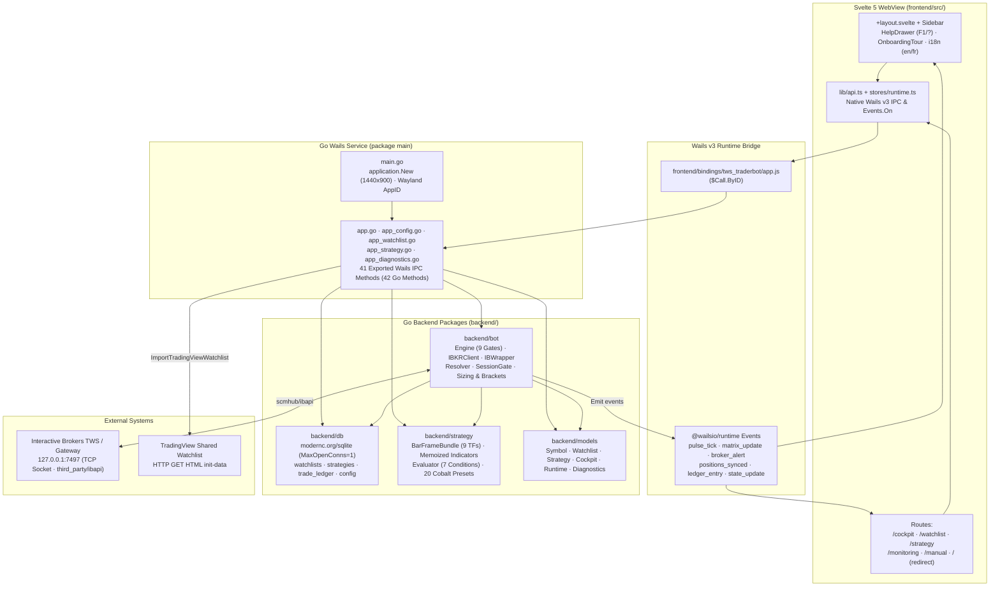
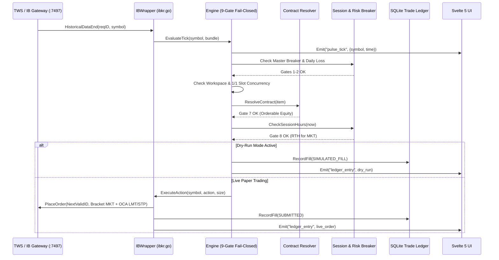

# System Architecture (`02_present_state`)

> **Navigation:** [Master Index](../00_index.md) | **Related:** [Capability Matrix](./capability_matrix.md) · [Legacy & Migration](../01_history_and_evolution/legacy_and_migration.md) · [Engineering Playbook](../05_engineering_and_agents/engineering_playbook.md)  
> **Status:** `Active`

---

## 1. High-Level Topology (`wails3` Branch `HEAD`)

`tws_traderbot` is a single-process desktop workstation built on **Go `1.26`**, **Wails v3** (`v3.1.0`), **Svelte 5** (`runes: false`, static SvelteKit build embedded via `//go:embed all:frontend/dist`), **`modernc.org/sqlite`**, and **`github.com/scmhub/ibapi`**.



---

## 2. Entrypoint, Services & Wails v3 IPC Surface

### 2.1 Bootstrap & Service Lifecycle ([`main.go`](../../main.go), [`app.go`](../../app.go))

1. [`main.go`](../../main.go) embeds the compiled SvelteKit output (`//go:embed all:frontend/dist`) and Cobalt raster icon (`//go:embed build/appicon.png`), instantiates `application.New(...)` with `Linux: application.LinuxOptions{ApplicationID: "ca.boostao.tws_traderbot", ProgramName: "ca.boostao.tws_traderbot"}`, registers `NewApp(app)` via `app.RegisterService(application.NewService(svc))`, opens a `1440x900` (`MinWidth: 1024`, `MinHeight: 700`) `WebviewWindow` titled `"Cobalt — Poste de pilotage TWS"`, and calls `app.Run()`.
2. `NewApp` opens `tws_traderbot.sqlite` via `db.Connect` (`SetMaxOpenConns(1)`, WAL mode, foreign keys ON), executes `InitSchema()` creating relational tables (`watchlists`, `watchlist_items`, `strategies`, `trade_ledger`, `system_config`), runs idempotent migrations (`migrateStrategiesTable()`, `migrateLegacyCobaltV2Data()`), seeds 5 official Cobalt watchlists (with empty `positions-detenues`) and 20 strategy presets, initializes `bot.NewEngine()`, attaches the DB to `Engine.AttachDB()`, and wires `bot.NewIBKRClient(engine)`.
3. `App.ServiceStartup(ctx, options)` attaches the `application.App` reference (`a.engine.AttachApp(a.app)`), hydrates config and `CockpitState` / active strategy onto `Engine`, loads `tws_connection` from `system_config` (falling back to `config.ib`, defaults `127.0.0.1:7497`, `client_id: 1`), launches `a.ibkrClient.Connect(host, port, clientID)` asynchronously, and starts a `1s` `state_update`/`pulse_tick` telemetry ticker.

### 2.2 Exported Wails v3 Methods ([`frontend/bindings/tws_traderbot/app.js`](../../frontend/bindings/tws_traderbot/app.js) — 41 IPC Functions / 42 Go `*App` Methods)

| Domain | Method | Source File | Responsibility |
|---|---|---|---|
| **TWS Connection** | `GetTWSConnection()` | [`app.go`](../../app.go) | Load `tws_connection` JSON map from `system_config` |
| **TWS Connection** | `UpdateTWSConnection(host, port, clientID)` | [`app.go`](../../app.go) | Persist `tws_connection` & `config.ib`, disconnect, and reconnect `ibkrClient` |
| **TWS Connection** | `ConnectTws(host, port, clientID)` | [`app.go`](../../app.go) | Wrapper returning `{"status": "ok" \| "error"}` |
| **TWS Connection** | `DisconnectTws()` | [`app.go`](../../app.go) | Disconnect `ibkrClient` socket |
| **Runtime & Safety** | `GetRuntimeState()` | [`app.go`](../../app.go) | Return full `*models.BotState` (live equity, cash USD/CAD/BASE, positions, orders, alerts, strategy) |
| **Runtime & Safety** | `StartBot()` | [`app.go`](../../app.go) | Start `Engine` with active/resolved strategy |
| **Runtime & Safety** | `StopBot()` | [`app.go`](../../app.go) | Call `a.engine.StopBot()` |
| **Runtime & Safety** | `FailsafeStop()` | [`app.go`](../../app.go) | Persist `GlobalEnabled=false`, stop engine, and disconnect TWS socket |
| **Runtime & Safety** | `ResetCircuitBreaker()` | [`app_diagnostics.go`](../../app_diagnostics.go) | Reset automated daily loss risk breaker (guarding against active breach) |
| **Runtime & Safety** | `DryRunBot()` | [`app_diagnostics.go`](../../app_diagnostics.go) | Evaluate active workspace, strategy, and watchlist against `BarFrameBundle` without live orders |
| **System Config** | `GetConfig()` / `UpdateConfig(update)` | [`app_config.go`](../../app_config.go) | Read/deep-merge `system_config['config']` & sync `ib.*` back to `tws_connection` |
| **Cockpit State** | `GetCockpitState()` / `UpdateCockpitState(update)` | [`app.go`](../../app.go) | Load/seed/save relational cockpit state with `1/1` concurrency & breaker clamping |
| **Watchlists** | `GetWatchlists()` | [`app_watchlist.go`](../../app_watchlist.go) | Return summaries for all stored watchlists |
| **Watchlists** | `GetWatchlist()` / `GetWatchlistById(id)` | [`app_watchlist.go`](../../app_watchlist.go) | Return default watchlist or full relational watchlist by ID |
| **Watchlists** | `SaveWatchlist(wl)` | [`app_watchlist.go`](../../app_watchlist.go) | Persist complete watchlist and its normalized child items |
| **Watchlists** | `ReplaceWatchlist(req)` | [`app_watchlist.go`](../../app_watchlist.go) | Atomically swap watchlist groups/items while preserving title & feed URL |
| **Watchlists** | `RefreshWatchlistFeed(id)` | [`app_watchlist.go`](../../app_watchlist.go) | Re-fetch feed with smart diff/merge preserving operator overrides |
| **Watchlists** | `ImportTradingViewWatchlist(url, ...targetWatchlistID)` | [`app_watchlist.go`](../../app_watchlist.go) | Fetch HTML, extract `application/prs.init-data+json`, normalize to `SYMBOL.VENUE` |
| **Watchlists** | `ImportWatchlistFile()` / `ExportWatchlistFile()` | [`app_watchlist.go`](../../app_watchlist.go) | Native OS open/save JSON file dialogs for `WatchlistResponse` |
| **Watchlists** | `AddWatchlistSymbol(symbol)` / `RemoveWatchlistSymbol(symbol)` | [`app_watchlist.go`](../../app_watchlist.go) | Add normalized item or remove across watchlist |
| **Strategy Library** | `GetStrategyLibrary()` | [`app_strategy.go`](../../app_strategy.go) | Return all strategy presets ordered by `(pinned DESC, sort_order ASC, name ASC)` |
| **Strategy Library** | `GetStrategyPreset(id)` | [`app_strategy.go`](../../app_strategy.go) | Retrieve specific strategy preset by ID |
| **Strategy Library** | `SaveStrategyPreset(strat)` | [`app_strategy.go`](../../app_strategy.go) | Save/update strategy preset (preserving `pinned`/`sort_order` & refreshing active engine strategy) |
| **Strategy Library** | `ToggleStrategyPin(id)` / `MoveStrategyOrder(id, direction)` | [`app_strategy.go`](../../app_strategy.go) | Persist stack pin toggle and intra-group `up`/`down` ordering |
| **Strategy Library** | `DeleteStrategyPreset(id)` | [`app_strategy.go`](../../app_strategy.go) | Delete strategy preset from library |
| **Strategy Library** | `ApplyStrategyPreset(ws, slot, stratID)` | [`app_strategy.go`](../../app_strategy.go) | Bind preset to workspace slot with `1/1` concurrency check |
| **Strategy Library** | `ValidateStrategy(strat)` | [`app_strategy.go`](../../app_strategy.go) | Validate rule names, supported condition types, `IndicatorA`, and `buy`/`sell`/`filter` actions |
| **Active Strategy** | `GetStrategy()` / `UpdateStrategy(update)` | [`app_config.go`](../../app_config.go) | Persist `system_config['strategy']` & hot-reload `engine.ActiveStrategy` |
| **Strategy Files** | `ImportStrategyFile()` / `ExportStrategyFile(strategy)` | [`app_config.go`](../../app_config.go) | Native OS open/save JSON file dialogs via `a.app.Dialog` |
| **Diagnostics** | `GetDiagnostics()` | [`app_diagnostics.go`](../../app_diagnostics.go) | Return clean connection, runtime, `NY/Toronto` session status, and `BrokerAlerts` |
| **Diagnostics** | `GetRecentTrades()` | [`app_diagnostics.go`](../../app_diagnostics.go) | Return last 50 execution records from `trade_ledger` |
| **Diagnostics** | `GetSymbols(query)` | [`app_watchlist.go`](../../app_watchlist.go) | Query matching symbols from SQLite `watchlist_items` |
| **Utility** | `Greet(name)` | [`app.go`](../../app.go) | Template diagnostic greeting |

---

## 3. SQLite Persistence Schema (`backend/db/`)

[`backend/db/sqlite.go`](../../backend/db/sqlite.go) opens `tws_traderbot.sqlite` via pure-Go `modernc.org/sqlite` in WAL mode with foreign keys enabled, and executes `InitSchema()`:

```sql
CREATE TABLE IF NOT EXISTS watchlists (
    id TEXT PRIMARY KEY,
    name TEXT NOT NULL,
    description TEXT DEFAULT '',
    is_default BOOLEAN DEFAULT FALSE,
    source TEXT DEFAULT 'manual',
    feed_url TEXT DEFAULT '',
    updated_at DATETIME DEFAULT CURRENT_TIMESTAMP
);

CREATE TABLE IF NOT EXISTS watchlist_items (
    id INTEGER PRIMARY KEY AUTOINCREMENT,
    watchlist_id TEXT NOT NULL,
    group_id TEXT DEFAULT 'default',
    group_name TEXT DEFAULT 'Default',
    symbol TEXT NOT NULL,
    exchange TEXT NOT NULL,
    venue TEXT DEFAULT 'SMART',
    instrument_id TEXT NOT NULL,
    name TEXT DEFAULT '',
    enabled BOOLEAN DEFAULT TRUE,
    tier TEXT DEFAULT '2-Croissance',
    is_orderable BOOLEAN DEFAULT TRUE,
    is_regime_reference BOOLEAN DEFAULT FALSE,
    is_holding BOOLEAN DEFAULT FALSE,
    size_mode TEXT DEFAULT 'shares',
    size_value REAL DEFAULT 100.0,
    size_val REAL DEFAULT 100.0,
    created_at DATETIME DEFAULT CURRENT_TIMESTAMP,
    updated_at DATETIME DEFAULT CURRENT_TIMESTAMP,
    FOREIGN KEY (watchlist_id) REFERENCES watchlists(id) ON DELETE CASCADE,
    UNIQUE(watchlist_id, instrument_id)
);

CREATE INDEX IF NOT EXISTS idx_watchlist_items_wid ON watchlist_items(watchlist_id);
CREATE INDEX IF NOT EXISTS idx_watchlist_items_inst ON watchlist_items(instrument_id);
CREATE INDEX IF NOT EXISTS idx_watchlist_items_enabled ON watchlist_items(watchlist_id, enabled);
CREATE INDEX IF NOT EXISTS idx_watchlist_items_orderable ON watchlist_items(is_orderable);
CREATE INDEX IF NOT EXISTS idx_watchlist_items_tier ON watchlist_items(tier);

CREATE TABLE IF NOT EXISTS system_config (
    key TEXT PRIMARY KEY,
    value JSON
);

CREATE TABLE IF NOT EXISTS strategies (
    id TEXT PRIMARY KEY,
    name TEXT NOT NULL,
    summary JSON,
    data JSON,
    pinned BOOLEAN NOT NULL DEFAULT 0,
    sort_order INTEGER NOT NULL DEFAULT 0,
    updated_at DATETIME DEFAULT CURRENT_TIMESTAMP
);

CREATE TABLE IF NOT EXISTS trade_ledger (
    id INTEGER PRIMARY KEY AUTOINCREMENT,
    order_id INTEGER NOT NULL,
    symbol TEXT NOT NULL,
    action TEXT NOT NULL,
    quantity INTEGER NOT NULL,
    price REAL NOT NULL,
    status TEXT NOT NULL,
    oca_group TEXT DEFAULT '',
    mode TEXT NOT NULL,
    created_at DATETIME DEFAULT CURRENT_TIMESTAMP
);

CREATE INDEX IF NOT EXISTS idx_trade_ledger_symbol ON trade_ledger(symbol);
CREATE INDEX IF NOT EXISTS idx_trade_ledger_mode ON trade_ledger(mode);
```

- **Relational Watchlist & Strategy Store:** All watchlist entries, groups, and items are stored relationally with cascading deletion and multi-column indexes. `db.Connect` configures `SetMaxOpenConns(1)` / `SetMaxIdleConns(1)` with `WAL` + `busy_timeout(5000)` + `foreign_keys(1)` to avoid `SQLITE_BUSY` on concurrent writes. `InitSchema()` runs `migrateStrategiesTable()` (`pinned`/`sort_order` on legacy DBs) and `migrateLegacyCobaltV2Data()` (purging legacy seeded `AAPL.NASDAQ`/`SHOP.TSX` from `positions-detenues`).
- **System Config & Ledger:** Global runtime settings (`tws_connection`, `config`, `strategy`, `cockpit_state`, `migration_cobalt_v2_clean_holdings`) live in `system_config`, while all executed orders and dry-run fills are auditable via `trade_ledger`.

---

## 4. Domain Models (`backend/models/`)

- [`symbol.go`](../../backend/models/symbol.go): `NormalizedSymbol`, `ClassifySymbol`, `HasExchangeSuffix`, and `NormalizeSymbol` (`SYMBOL.VENUE` qualification and orderable vs. regime classification).
- [`watchlist.go`](../../backend/models/watchlist.go): `WatchlistSummary`, `WatchlistResponse`, `WatchlistGroup`, `WatchlistItem` (with `Tier`, `IsOrderable`, `IsRegimeReference`, `IsHolding`, `SizeMode`, `SizeValue`).
- [`cockpit.go`](../../backend/models/cockpit.go): `CockpitStateResponse`, `CockpitWorkspace` (`Achat`, `Short`, `Swing`), `CockpitStrategySlot` (strict `1/1` active slot concurrency), and `CockpitStrategySummary` (`Pinned`, `SortOrder`).
- [`strategy.go`](../../backend/models/strategy.go):
  - 9 Timeframes: `1m`, `5m`, `15m`, `30m`, `1h`, `4h`, `1d`, `1w`, `1M`.
  - 22 `IndicatorType` definitions (`price`..`ml_signal`, with `ml_signal` retained only as a legacy compatibility fallback).
  - Condition Types: `cross_above`, `crosses_above`, `cross_below`, `crosses_below`, `greater_than`, `less_than`, `slope_above`, `slope_below`, `within_range`; `ActionBuy`, `ActionSell`, `ActionFilter`; `ValidateStrategy` enforcing condition type & `IndicatorA`.
  - Position Sizing Modes: `shares`, `dollar` / `notional`, `percent`.
- [`runtime.go`](../../backend/models/runtime.go) & [`diagnostics.go`](../../backend/models/diagnostics.go): `BrokerPosition`, `BrokerOrder`, `BrokerAlert`, `BotState` (`account_id`, `dry_run`, `equity` `0` when unreported, `buying_power`, `cash_usd`, `cash_cad`, `cash_base`, `realized_pnl`, `unrealized_pnl`, `session_status`, `open_positions`, `open_orders`, `broker_alerts`), `BotDryRun`, and de-noised `DiagnosticsResponse`.
- [`ledger.go`](../../backend/models/ledger.go): `TradeRecord` (`OrderID`, `Symbol`, `Action`, `Quantity`, `Price`, `Status`, `OCAGroup`, `Mode`, `CreatedAt`).

---

## 5. Strategy & Array-Math Engine (`backend/strategy/`)

- [`barframe.go`](../../backend/strategy/barframe.go):
  - `BarFrameBundle`: hierarchical `symbol -> timeframe -> BarFrame` maintaining thread-safe OHLCV bar series across all 9 Cobalt timeframes with fast snapshotting and append operations.
- [`indicators.go`](../../backend/strategy/indicators.go):
  - Memoized indicator computation pipeline caching computed indicator series; handles Heikin-Ashi, RVOL, OBV, MACD, RSI, Bollinger Bands, Stochastic, Williams Alligator, Guppy MMA, ATR, and Relative Strength vs SPX. Includes strict zero-division and empty-series guards.
- [`evaluator.go`](../../backend/strategy/evaluator.go):
  - Evaluates rule conditions against memoized indicator outputs, supporting all 7 condition types (`cross_above`, `cross_below`, `greater_than`, `less_than`, `slope_above`, `slope_below`, `within_range`).
- [`catalog.go`](../../backend/strategy/catalog.go):
  - Seeds the 20 official Cobalt strategies, Screener 2.0 presets, and Cours setups directly into SQLite.

---

## 6. Bot Execution Loop & IBKR Wrapper (`backend/bot/`)



### Component Details

- **[`engine.go`](../../backend/bot/engine.go):**
  - Fail-closed 9-gate execution pipeline (`CanExecute`):
    1. Master Circuit Breaker (`global_enabled` coupe-circuit principal)
    2. Daily Loss Risk Breaker (trips automatically on loss limit breach)
    3. Engine Running State
    4. Active Workspace Enabled (`Achat`, `Short`, `Swing`)
    5. Single Active Strategy Slot (1/1 concurrency)
    6. Watchlist Item Enabled
    7. Orderable Equity Invariant (`IsOrderable && !IsRegimeReference`)
    8. Session Gate (`session.go`: RTH vs ETH, blocks MKT orders during ETH)
    9. Sizing & Dry-Run Guard: Calculates position size (`# shares`, `$ notional`, `% portfolio`); routes dry-run fills to SQLite `trade_ledger` without calling live `PlaceOrder`.
- **[`journal.go`](../../backend/bot/journal.go):**
  - Async event journaling for state changes and order events, with throttling for Wails IPC efficiency.
- **[`resolver.go`](../../backend/bot/resolver.go):**
  - Multi-venue contract resolution for US (`SMART/USD`) and Canadian (`SMART/CAD` with TSE/VENTURE/PURE) instruments; dot-class normalization (`BRK B`, `CTC A`).
- **[`order.go`](../../backend/bot/order.go):**
  - Position sizing (`CalculatePositionSize`) and OCA child bracket order creation (`CreateBracketOrders`: `MKT` parent + OCA `LMT` + OCA `STP`).
- **[`ibkr.go`](../../backend/bot/ibkr.go) & `third_party/ibapi`:**
  - Atomic thread-safe `NextValidID` / `NextOrderID` sequencing; `IBWrapper` implements live TWS telemetry ingestion (`ConnectAck`, `ConnectionClosed`, `ManagedAccounts` dynamic account capture, `AccountSummary`, `UpdateAccountValue` native `USD`/`CAD`/`BASE` cash, `Position`, `PositionEnd` $\rightarrow$ `SyncLivePositionsToDB`, `UpdatePortfolio`, `OpenOrder`, `OpenOrderEnd`, `OrderStatus`, `Pnl`, and `BuildBrokerAlert` for `10089`/`504`/`502`/`1100`–`1102`) using race-hardened `third_party/ibapi@v0.10.50` (per-connection watcher lifecycle, atomic `ServerVersion`/`IsConnected()`, synchronized request queue).
- **[`session.go`](../../backend/bot/session.go):**
  - NY/Toronto Eastern Time market session classification (`RTH`, `Pre-ETH`, `Post-ETH`, `CLOSED`) and `FormatSessionStatus`, enforcing session-safe order routing.

---

## 7. Frontend Cockpit, Routes & i18n (`frontend/src/`)

[`frontend/svelte.config.js`](../../frontend/svelte.config.js) compiles Svelte 5 with `compilerOptions: { runes: false }` and `@sveltejs/adapter-static` (`fallback: 'index.html'`, output `frontend/dist/`).

- **Clean-Break Wails v3 IPC ([`lib/api.ts`](../../frontend/src/lib/api.ts)):**
  - 100% native IPC bindings through `$Call.ByID` without legacy REST stubs or `(window as any).go` shims.
- **Cobalt Brand Shell, Sidebar & Global Overlays ([`cobalt_brand_and_ui_guide.md`](./cobalt_brand_and_ui_guide.md)):**
  - [`Sidebar.svelte`](../../frontend/src/lib/components/Sidebar.svelte): Cobalt geometric emblem, single authoritative `status-badge`, and collapsible Broker & Risk sections with 1-line summary chips; global dark `<select>`/`<option>` styling in [`app.css`](../../frontend/src/app.css).
  - [`HelpDrawer.svelte`](../../frontend/src/lib/components/HelpDrawer.svelte) (`F1`/`?`) & 3-track [`OnboardingTour.svelte`](../../frontend/src/lib/components/OnboardingTour.svelte) (`localStorage`-persisted `cobalt_onboarding_state`).
- **Operator Cockpit ([`routes/cockpit/+page.svelte`](../../frontend/src/routes/cockpit/+page.svelte)):**
  - Locked `.cockpit-shell` (`auto auto minmax(0, 1fr)`) & compact single-bar `.cockpit-hud-strip`, 3 workspaces (`Achat`, `Short`, `Swing`), `1/1` Active Strategy Card + `(pinned DESC, sort_order ASC)` Strategy Stack (`📌`, `↑`/`↓`, `>= 78%` [`SlideToArm.svelte`](../../frontend/src/lib/components/SlideToArm.svelte)), watchlist pills, and Uni Noir single-line ticker rows (`SYMBOL`, `VENUE`, tier, `$$$$` holding badge, `#`/`$`/`%` sizing, suspend toggle).
- **Monitoring, Strategy Workbench, Watchlist & Manual Views:**
  - [`routes/monitoring/+page.svelte`](../../frontend/src/routes/monitoring/+page.svelte): 4 trader panels (Portfolio & `FXCONV` Currency Readiness, Live Open Positions, Working Orders & Dry-Run Scanner, Execution & Session/Alert Ledger).
  - [`routes/strategy/+page.svelte`](../../frontend/src/routes/strategy/+page.svelte): Zero-scroll 3-pane workbench (Preset Stack, `Filtres Macro → Entrées → Sorties` pipeline, 2-col Rule Inspector, slide-over JSON drawer).
  - [`routes/watchlist/+page.svelte`](../../frontend/src/routes/watchlist/+page.svelte) (with live `$$$$` holdings view) & [`routes/manual/+page.svelte`](../../frontend/src/routes/manual/+page.svelte) (Cobalt Operator Manual + 1-click tour launchers).
- **Bilingual i18n Parity ([`lib/i18n/translations.ts`](../../frontend/src/lib/i18n/translations.ts)):**
  - 100% key parity (`928` symmetric EN/FR keys) with reactive live switching (`$language`) preserving unsaved route state.
