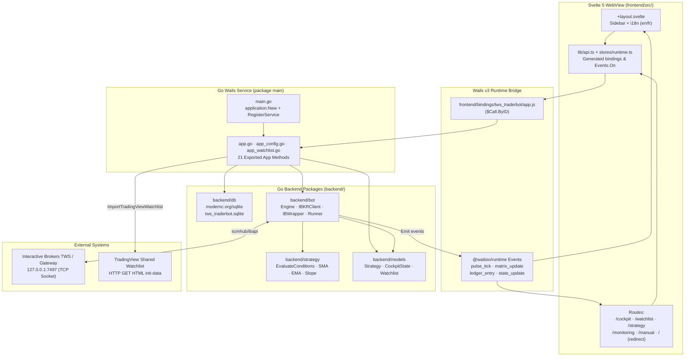
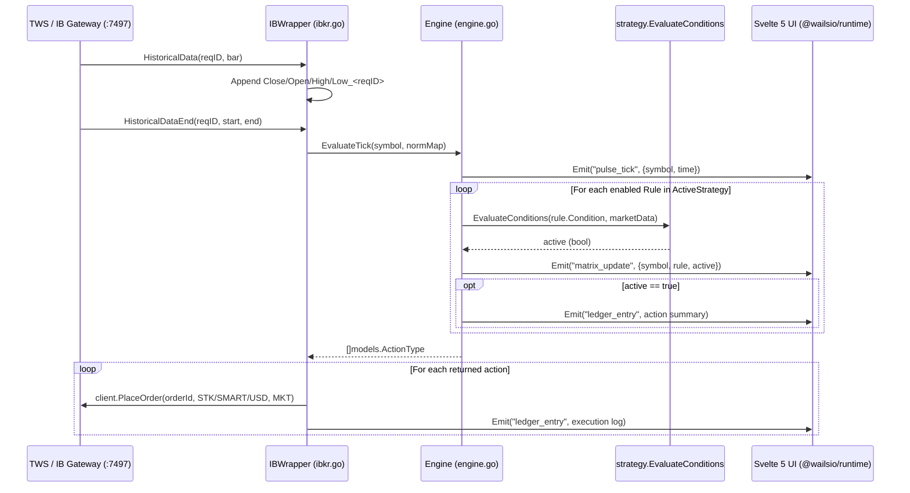

# System Architecture (`02_present_state`)

> **Navigation:** [Master Index](../00_index.md) | **Related:** [Capability Matrix](./capability_matrix.md) · [Legacy & Migration](../01_history_and_evolution/legacy_and_migration.md) · [Engineering Playbook](../05_engineering_and_agents/engineering_playbook.md)  
> **Status:** `Active`

---

## 1. High-Level Topology (`wails3` Branch `HEAD`)

`tws_traderbot` is a single-process desktop workstation built on **Go `1.26`**, **Wails v3** (`github.com/wailsapp/wails/v3 v3.0.0-alpha.96`), **Svelte 5** (`runes: false`, static SvelteKit build embedded via `//go:embed all:frontend/dist`), **`modernc.org/sqlite`**, and **`github.com/scmhub/ibapi`**.



---

## 2. Entrypoint, Services & Wails v3 IPC Surface

### 2.1 Bootstrap & Service Lifecycle ([`main.go`](../../main.go), [`app.go`](../../app.go))

1. [`main.go`](../../main.go) embeds the compiled SvelteKit output (`//go:embed all:frontend/dist`), instantiates `application.New(...)` with `application.AssetFileServerFS(assets)`, registers `NewApp(app)` via `app.RegisterService(application.NewService(svc))`, opens a `1024x768` `WebviewWindow`, and calls `app.Run()`.
2. `NewApp` opens `tws_traderbot.sqlite` via `db.Connect`, initializes `bot.NewEngine()`, and wires `bot.NewIBKRClient(engine)`.
3. `App.ServiceStartup(ctx, options)` attaches the `application.App` reference (`a.engine.AttachApp(a.app)`), loads `tws_connection` from `system_config` (seeding defaults `host: "127.0.0.1"`, `port: 7497`, `client_id: 1` if missing), and launches a background goroutine calling `a.ibkrClient.Connect(host, port, clientID)`.

> **Note:** [`backend/api/manager.go`](../../backend/api/manager.go) currently contains only `package api` (an empty placeholder); all IPC methods live directly on `App` in root `package main`.

### 2.2 Exported Wails v3 Methods ([`frontend/bindings/tws_traderbot/app.js`](../../frontend/bindings/tws_traderbot/app.js))

| Domain | Method | Source File | Responsibility |
|---|---|---|---|
| **TWS Connection** | `GetTWSConnection()` | [`app.go`](../../app.go) | Load `tws_connection` JSON map from `system_config` |
| **TWS Connection** | `UpdateTWSConnection(host, port, clientID)` | [`app.go`](../../app.go) | Persist `tws_connection`, disconnect, and reconnect `ibkrClient` |
| **TWS Connection** | `ConnectTws(host, port, clientID)` | [`app.go`](../../app.go) | Wrapper returning `{"status": "ok" \| "error"}` |
| **TWS Connection** | `DisconnectTws()` | [`app.go`](../../app.go) | Disconnect `ibkrClient` socket |
| **Runtime Safety** | `GetRuntimeState()` | [`app.go`](../../app.go) | Return `*models.BotState` (`{running}`) |
| **Runtime Safety** | `StartBot()` | [`app.go`](../../app.go) | Call `a.engine.StartBot(&models.Strategy{})` |
| **Runtime Safety** | `StopBot()` | [`app.go`](../../app.go) | Call `a.engine.StopBot()` |
| **Runtime Safety** | `FailsafeStop()` | [`app.go`](../../app.go) | Stop engine and disconnect TWS socket |
| **System Config** | `GetConfig()` / `UpdateConfig(update)` | [`app_config.go`](../../app_config.go) | Read/merge-write `system_config['config']` |
| **Strategy** | `GetStrategy()` / `UpdateStrategy(update)` | [`app_config.go`](../../app_config.go) | Persist `system_config['strategy']` & hot-reload `engine.ActiveStrategy` |
| **Strategy Files** | `ImportStrategyFile()` / `ExportStrategyFile(strategy)` | [`app_config.go`](../../app_config.go) | Native OS open/save JSON file dialogs via `a.app.Dialog` |
| **Cockpit** | `GetCockpitState()` / `UpdateCockpitState(update)` | [`app.go`](../../app.go) | Load/seed/save `system_config['cockpit_state']` |
| **Watchlist** | `GetWatchlist()` | [`app_watchlist.go`](../../app_watchlist.go) / [`app.go`](../../app.go) | Load `system_config['watchlist_state']` or default `manual` group |
| **Watchlist** | `ImportTradingViewWatchlist(url)` | [`app_watchlist.go`](../../app_watchlist.go) | Fetch HTML, extract `application/prs.init-data+json`, parse `###` groups |
| **Watchlist** | `ImportWatchlistFile()` / `ExportWatchlistFile()` | [`app_watchlist.go`](../../app_watchlist.go) | Native OS open/save JSON file dialogs for `WatchlistResponse` |
| **Watchlist** | `AddWatchlistSymbol(symbol)` / `RemoveWatchlistSymbol(symbol)` | [`app_watchlist.go`](../../app_watchlist.go) | Mutate `manual` group or remove symbol across all groups |
| **Utility** | `Greet(name)` | [`app.go`](../../app.go) | Template diagnostic greeting |

---

## 3. SQLite Persistence Schema (`backend/db/`)

[`backend/db/sqlite.go`](../../backend/db/sqlite.go) opens `tws_traderbot.sqlite` via `sql.Open("sqlite", dbPath)` using pure-Go `modernc.org/sqlite` and executes `InitSchema()`:

```sql
CREATE TABLE IF NOT EXISTS watchlist (
    symbol TEXT PRIMARY KEY,
    exchange TEXT,
    name TEXT,
    enabled BOOLEAN,
    instrument_id TEXT
);

CREATE TABLE IF NOT EXISTS system_config (
    key TEXT PRIMARY KEY,
    value JSON
);
```

- **Document-Store Pattern:** Although the relational `watchlist` table is created in DDL, all active reads/writes use `system_config` via `INSERT ... ON CONFLICT(key) DO UPDATE SET value=excluded.value`:
  - `'tws_connection'` ([`app.go`](../../app.go), [`config.go`](../../backend/db/config.go)): `{host, port, client_id}`
  - `'config'` ([`app_config.go`](../../app_config.go)): sidebar `ib` and `runtime` settings map
  - `'strategy'` ([`app_config.go`](../../app_config.go)): active strategy JSON payload
  - `'cockpit_state'` ([`cockpit.go`](../../backend/db/cockpit.go)): serialized `models.CockpitStateResponse`
  - `'watchlist_state'` ([`watchlist.go`](../../backend/db/watchlist.go)): serialized `models.WatchlistResponse` (`symbols`, `groups`, `feed`, `updated_at`)

---

## 4. Domain Models (`backend/models/`)

- [`runtime.go`](../../backend/models/runtime.go): `BotState { Running bool }` (`json:"running"`).
- [`schemas.go`](../../backend/models/schemas.go):
  - Watchlist types: `WatchlistItem` (`symbol`, `exchange`, `name`, `enabled`, `instrument_id`), `WatchlistGroup` (`id`, `name`, `source`, `items`), `WatchlistFeed` (`provider`, `url`, `title`, `external_id`, `last_refreshed_at`), `WatchlistResponse`.
  - Cockpit types: `CockpitStrategySummary`, `CockpitStrategySlot` (`id`, `label`, `strategy_id`, `enabled`), `CockpitWorkspace` (`id`, `name`, `kind`, `enabled`, `strategy_slots`), `CockpitStateResponse` (`global_enabled`, `active_workspace_id`, `workspaces`, `strategy_library`, `feed`, `updated_at`).
- [`strategy.go`](../../backend/models/strategy.go):
  - `RuleScope`: `global`, `symbol`, `instrument`
  - `ActionType`: `buy`, `sell`, `filter`, `alert`
  - `ConditionType`: `cross_above`, `cross_below`, `greater_than`, `less_than`, `slope_above`, `slope_below`, `within_range`
  - `IndicatorType`: `price`, `ema`, `sma`, `rsi`, `macd`, `vix`, `time`
  - `TimeframeUnit`: `1m`, `5m`, `15m`, `1h`, `1d`
  - Structs: `Indicator` (`type`, `timeframe`, `period`, `source`), `Condition` (`type`, `indicator_a`, `indicator_b`, `threshold`, `lookback_periods`, `range_start`, `range_end`), `Rule` (`name`, `scope`, `condition`, `action`, `enabled`), `Strategy` (`id`, `name`, `description`, `rules`, `created_at`, `updated_at`).

---

## 5. Strategy & Array-Math Engine (`backend/strategy/`)

- [`math.go`](../../backend/strategy/math.go):
  - `SMA(data []float64, period int) []float64`: Returns a slice matching `len(data)`; indices `< period-1` are filled with `math.NaN()`, followed by rolling arithmetic means.
  - `EMA(data []float64, period int) []float64`: Uses `alpha = 2.0 / (float64(period) + 1.0)`, fills `i < period-1` with `math.NaN()`, initializes `out[period-1]` with the SMA over the warm-up window, and applies recursive EMA `(data[i] - out[i-1])*alpha + out[i-1]`.
- [`evaluator.go`](../../backend/strategy/evaluator.go):
  - `CrossAbove(seriesA, seriesB []float64) bool`: Checks `seriesA[last-1] <= seriesB[last-1] && seriesA[last] > seriesB[last]`.
  - `Slope(series []float64, lookback int) float64`: Computes `(series[last] - series[last-lookback]) / float64(lookback)`.
  - `EvaluateConditions(c *models.Condition, data map[string][]float64) bool`: Evaluates `ConditionCrossAbove` (`"indicatorA"` vs `"indicatorB"`), `ConditionGreater` (`"indicatorA"` last element `> c.Threshold`), and `ConditionSlopeBelow` (`Slope(indicatorA, c.LookbackPeriods) < c.Threshold`).
- **Multi-Timeframe Frame Bundle Compatibility:** While Go's `EvaluateConditions` currently consumes flat `map[string][]float64` series, project guardrails require any indicator pipeline extension to preserve compatibility with both flat maps and nested `symbol -> timeframe -> frame` bundles (mirroring legacy `market_data.py` so multi-timeframe rules like `5m` entries gated by `1d` trend filters can be evaluated consistently).

---

## 6. Bot Execution Loop & IBKR Wrapper (`backend/bot/`)

> **Note:** `backend/wrapper/` is currently an empty directory on disk; `IBWrapper` is implemented inside [`backend/bot/ibkr.go`](../../backend/bot/ibkr.go).



### Component Details

- **[`engine.go`](../../backend/bot/engine.go):**
  - `Engine` holds `ActiveStrategy *models.Strategy`, `IsRunning bool`, and `App *application.App`.
  - `EvaluateTick(symbol, marketData)` returns immediately if `!e.IsRunning || e.ActiveStrategy == nil`; emits `pulse_tick`, evaluates enabled rules via `strategy.EvaluateConditions`, emits `matrix_update`, and emits `ledger_entry` for triggered actions.
  - `StartBot(s)` flips `IsRunning = true` and assigns `ActiveStrategy = s`; `StopBot()` sets `IsRunning = false`.
- **[`ibkr.go`](../../backend/bot/ibkr.go):**
  - `IBKRClient` wraps `*ibapi.EClient` and `*IBWrapper`.
  - `IBWrapper` embeds `ibapi.Wrapper` and overrides:
    - `Error(...)`: suppresses informational IBKR market/historical data-farm connection messages (`2104`, `2106`, `2158`).
    - `HistoricalData(reqID, bar)`: appends OHLC floats keyed by `Close_<reqID>`, `Open_<reqID>`, `High_<reqID>`, `Low_<reqID>`.
    - `HistoricalDataEnd(reqID, ...)`: builds `normMap` (`Close`, `Open`), runs `engine.EvaluateTick(symbol, normMap)`, and calls `ExecuteAction`.
    - `ExecuteAction(symbol, actionType)`: constructs an `ibapi.Contract` (`STK`, `SMART`, `USD`) and `MKT` `DAY` `ibapi.Order` (currently fixed at `100` quantity and mapping `"BUY"`/`"SELL"`), sends `w.client.PlaceOrder`, and emits `ledger_entry`.
- **[`runner.go`](../../backend/bot/runner.go):**
  - `Runner` (`NewRunner`, `Start(strategyPath)`, `Stop()`) loads a `models.Strategy` JSON file from disk, connects to `127.0.0.1:7497` (`clientID: 1`), and starts `Engine`. Used primarily by integration test `TestFullRunnerFlow`.

---

## 7. Frontend Cockpit, Routes & i18n (`frontend/src/`)

[`frontend/svelte.config.js`](../../frontend/svelte.config.js) compiles Svelte 5 with `runes: false` and `@sveltejs/adapter-static` (`fallback: 'index.html'`, output `frontend/dist/`).

- **Shell ([`+layout.svelte`](../../frontend/src/routes/+layout.svelte), [`Sidebar.svelte`](../../frontend/src/lib/components/Sidebar.svelte)):**
  - Persistent sidebar with navigation links (`/cockpit`, `/monitoring`, `/watchlist`, `/strategy`, `/manual`), TWS connection & runtime risk settings form (`host`, `port`, `client_id`, `account`, `trading_mode`, `fixed_notional`, `bracket_enabled`, `stop_loss_pct`, `take_profit_pct`), Connect/Disconnect & Start/Stop Bot toggles, and `en` / `fr` language selector.
  - Subscribes to `state_update` Wails events via `startRuntimePolling()` in [`stores/runtime.ts`](../../frontend/src/lib/stores/runtime.ts).
- **Routes:**
  - **`/` ([`+page.ts`](../../frontend/src/routes/+page.ts) & [`+page.svelte`](../../frontend/src/routes/+page.svelte)):** `+page.ts` issues a `307` redirect to `/cockpit`, making Cockpit the active landing route while shadowing `+page.svelte` (which implements the Wails v3 3-panel Unified Dashboard listening to `pulse_tick`, `matrix_update`, and `ledger_entry`).
  - **`/cockpit` ([`routes/cockpit/+page.svelte`](../../frontend/src/routes/cockpit/+page.svelte)):** Operational dashboard with workspace tabs (`Main Trading` by default in Go, or `Achat`/`Short`/`Swing` when populated), global Main Breaker (`global_enabled`), workspace toggle, **single exclusive strategy slot** (`buildExclusiveStrategyWorkspaces` enforcing at most `1/1` active slot across workspaces), ticker search filter, and nested All / Group / Item toggles.
  - **`/watchlist` ([`routes/watchlist/+page.svelte`](../../frontend/src/routes/watchlist/+page.svelte)):** TradingView shared-watchlist URL import (`ImportTradingViewWatchlist`), native JSON import/export (`ImportWatchlistFile`, `ExportWatchlistFile`), manual symbol search component ([`SymbolSearch.svelte`](../../frontend/src/lib/components/SymbolSearch.svelte)), and group/item toggles. Draft URL persists across route changes via [`stores/ui.ts`](../../frontend/src/lib/stores/ui.ts) (`watchlistDraftUrl`).
  - **`/strategy` ([`routes/strategy/+page.svelte`](../../frontend/src/routes/strategy/+page.svelte)):** Rule builder form (`filter`, `buy`, `sell` rules; 16 UI indicator types; 7 condition types; timeframes `1m`–`1d`), Strategy Library preset panel, raw JSON editor, and native OS file import/export (`ImportStrategyFile`, `ExportStrategyFile`).
  - **`/monitoring` ([`routes/monitoring/+page.svelte`](../../frontend/src/routes/monitoring/+page.svelte)):** Mission Control view displaying runtime snapshot, startup diagnostics, dry-run preflight orders/subscriptions, and recent closed trades.
  - **`/manual` ([`routes/manual/+page.svelte`](../../frontend/src/routes/manual/+page.svelte)):** Bilingual (`en`/`fr`) interactive guide for TWS setup, Cockpit, Monitoring, Watchlist, and Strategy Builder.
- **i18n ([`lib/i18n/index.ts`](../../frontend/src/lib/i18n/index.ts), [`lib/i18n/translations.ts`](../../frontend/src/lib/i18n/translations.ts)):** Persists `'lang'` in `localStorage` (auto-detecting `fr` from `navigator.languages`), exposing `t(key, params)` across `en` and `fr` dictionaries.
