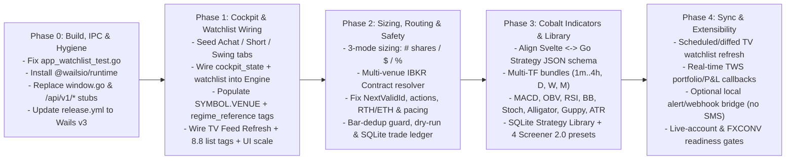

# Future Architecture & Rebuild Roadmap (`03_future_architecture`)

> **Navigation:** [Master Index](../00_index.md) | **Related:** [System Architecture](../02_present_state/system_architecture.md) · [Capability Matrix](../02_present_state/capability_matrix.md) · [Cobalt Indicators](../02_present_state/cobalt_indicators_and_courses.md) · [Cobalt Trading Universe](../02_present_state/cobalt_trading_universe.md) · [Decisions & Gaps](../04_evidence_and_sources/decisions_and_gaps.md)  
> **Status:** `Active`

---

## 1. Purpose & Gap-Closure Scope

This roadmap defines the concrete engineering phases required to close the gap between the current `wails3` branch (`HEAD` `22beb38`) of `tws_traderbot` and the operational requirements of the **Cobalt "vibe trader" workflow** (`Méthode de travail 8.8` `A -> A -> A`, `REGARD MATINAL` `3–4` focus titles, `Lesson 213` 13 chart templates, and `bruno 1.m4a` execution ergonomics) documented in [`02_present_state/`](../02_present_state/capability_matrix.md).

Rather than rewriting the Go/Wails v3/Svelte 5 foundation, work proceeds as five incremental stabilization and feature phases—preserving single-binary local execution over TWS Socket API (`127.0.0.1:7497`) while eliminating legacy HTTP stubs, wiring cockpit controls into `bot.Engine`, adding multi-venue/regime-feed routing and 3-mode position sizing, and implementing Cobalt's TradingView indicator and Screener 2.0 library in `backend/strategy/`.

---

## 2. Phase 0 — Build Unblocking, Wails v3 IPC Cleanup & CI Alignment

**Goal:** Ensure every Go package and Svelte view compiles cleanly against Wails v3 with zero defunct `/api/v1/*` REST fallbacks.

1. **Fix Root Go Test Compilation (`app_watchlist_test.go`):**
   - Remove the duplicate `package main` declaration on line 2 of [`app_watchlist_test.go`](../../app_watchlist_test.go) so `go test ./...` passes from the repository root alongside `go test -v ./backend/...`.
2. **Sync Frontend Dependencies & Remove Wails v2 Leftovers:**
   - Install `@wailsio/runtime` in `frontend/` (`npm install && npm run check && npm run build`) so `+page.svelte` and `frontend/src/lib/stores/runtime.ts` pass `svelte-check`.
   - Remove the superseded Wails v2 `frontend/wailsjs/` directory once all callers use [`frontend/bindings/tws_traderbot/app.js`](../../frontend/bindings/tws_traderbot/app.js).
   - Update [`.github/workflows/release.yml`](../../.github/workflows/release.yml) from Wails v2 (`main` branch, `wails build`) to Wails v3 (`wails3` / [`Taskfile.yml`](../../Taskfile.yml)) with GTK4/WebKitGTK 6.0 Linux build dependencies.
3. **Eliminate Wails v2 `window.go` Guards & Legacy `/api/v1/*` HTTP Stubs (`frontend/src/lib/api.ts`):**
   - Remove `(window as any).go` checks in [`frontend/src/lib/api.ts`](../../frontend/src/lib/api.ts) so `getStrategy`, `getConfig`, `updateConfig`, `getState`, `connectTws`, `disconnectTws`, `startBot`, `stopBot`, `getWatchlist`, and `getCockpit` invoke Wails v3 bindings unconditionally.
   - Replace the 15 HTTP `fetch(${API_BASE}/api/v1/...)` calls (`saveCockpit`, `replaceWatchlist`, `refreshWatchlistFeed`, `saveStrategy`, `validateStrategy`, `importStrategy*`, `*StrategyPreset*`, `dryRunBot`, `getDiagnostics`, `getSymbols`) with Wails v3 `App` methods (`UpdateCockpitState`, `UpdateStrategy`, new watchlist/library/diagnostics IPC methods).
4. **Hydrate Sidebar Settings & Clarify Landing Route:**
   - Implement `loadSidebarConfig()` in [`Sidebar.svelte`](../../frontend/src/lib/components/Sidebar.svelte) via `GetConfig()` so persisted IBKR/runtime fields (`account`, `trading_mode`, `fixed_notional`, `bracket_enabled`, `stop_loss_pct`, `take_profit_pct`) hydrate on startup.
   - Reconcile the shadowed `/` landing component ([`+page.svelte`](../../frontend/src/routes/+page.svelte) vs. the `307` redirect in [`+page.ts`](../../frontend/src/routes/+page.ts)) so the real-time Pulse/Matrix/Ledger panels live cleanly inside `/cockpit` or `/monitoring`.

---

## 3. Phase 1 — Cockpit-to-Engine Wiring, Multi-Workspace Seeding & Watchlist Sync

**Goal:** Make the trader's cockpit switches (`Main Breaker`, workspace tabs, strategy slots, and ticker toggles) authoritative over `bot.Engine` execution while keeping full-universe watchlist subscriptions intact.

1. **Seed Cobalt Workspaces (`Achat`, `Short`, `Swing`) in `App.GetCockpitState()`:**
   - Replace the single `"Main Trading"` default seed in [`app.go`](../../app.go#L138-L152) with the three Cobalt workspaces: **`Achat`** (`kind: "long"`), **`Short`** (`kind: "short"`), and **`Swing`** (`kind: "swing"`), each initialized with configured `CockpitStrategySlot` entries (preserving single-active or up to 4-slot cardinality per [`D-03`](../04_evidence_and_sources/decisions_and_gaps.md)).
2. **Wire Cockpit & Watchlist State into `bot.Engine` (`backend/bot/engine.go`, `app.go`):**
   - Fix `App.StartBot()` ([`app.go`](../../app.go#L209-L216)) so it loads the active strategy from `system_config['strategy']` / active cockpit slot instead of overwriting `engine.ActiveStrategy` with `&models.Strategy{}`.
   - Enforce the four-level gating chain inside `Engine.EvaluateTick()` (or an enclosing `ExecutionContext`):
     1. **`global_enabled` (Main Breaker)** must be `true`.
     2. **Active `CockpitWorkspace`** (`Achat` / `Short` / `Swing`) must have `enabled: true`.
     3. **Assigned `CockpitStrategySlot`** must be `enabled: true` with a resolved `Strategy`.
     4. **Target Ticker (`WatchlistItem`)** must have `enabled: true` within `watchlist_state` (preserving **suspend without deleting** so disabled symbols stay in the watchlist and retain market-data display without triggering orders).
3. **Populate `SYMBOL.VENUE` `instrument_id`, Regime Tags & `Méthode 8.8` Categorization (`app_watchlist.go`):**
   - Populate `WatchlistItem.InstrumentID` (`SYMBOL.VENUE`, e.g., `AAPL.NASDAQ`, `NPI.TSX`, `BTCUSD.COINBASE`) inside `ImportTradingViewWatchlist` and `AddWatchlistSymbol`, and key internal bar caches and `Engine` maps by `instrument_id` rather than bare `Symbol`. This eliminates the **8 exchange-stripped collisions** observed in `209453826` (`BTCUSD`, `ETHUSD`, `FETH`, `AQN`, `CNR`, `SPX`, `NFLX`, `MDA`).
   - Tag macro/benchmark items from `209453826` and `CBLT - MARCHÉS` (`40576813`, `54` symbols) as `regime_reference` / `filter_only` (`TVC:VIX`, `TVC:SPX`, `TVC:US02Y`–`US30Y`, `TVC:DXY`, `FX:*`, `CAPITALCOM:*`, `TSX:TSX`/`TX60`/`TX40`/`TX20`/`JX`) so rules can filter on macro trends without ever emitting equity orders.
   - Support optional `Méthode de travail 8.8` classification tags (`1-Blue Chip`, `2-Croissance`, `3-Spéculatif`, `4-Rejeté`, `($$$$)` owned holdings) and TradingView color-flag group metadata (`Lesson 215`).
4. **Native Watchlist Refresh & Symbol Search IPC:**
   - Add Wails v3 methods `SaveWatchlist(update)` (replacing HTTP `replaceWatchlist`) and `RefreshWatchlistFeed()` (replacing HTTP `refreshWatchlistFeed` by re-running `ImportTradingViewWatchlist(feed.URL)` while preserving user `enabled` toggles and per-ticker sizing overrides by `instrument_id`, avoiding TradingView's `.txt` duplicate-cleanup hazard from `Lesson 206`).
   - Add a Wails v3 `SearchSymbols(query)` binding backed by cached IBKR `ReqMatchingSymbols` or local universe index to replace `GET /api/v1/symbols` in [`SymbolSearch.svelte`](../../frontend/src/lib/components/SymbolSearch.svelte).
5. **High-Scale Cockpit UX & Complete `en`/`fr` i18n:**
   - Add optional page-size controls (`25 / 50 / 100 / All`) alongside live text filtering for 500–700+ ticker watchlists, enlarge high-contrast toggle/action targets (`messages.html` `#84`), and move all remaining hardcoded English strings in `monitoring/+page.svelte`, `+page.svelte`, and `cockpit/+page.svelte` into [`translations.ts`](../../frontend/src/lib/i18n/translations.ts).

---

## 4. Phase 2 — 3-Mode Position Sizing, Multi-Venue IBKR Routing & Execution Safety

**Goal:** Deliver trader-specified per-ticker sizing, multi-venue contract safety, TWS request pacing, bar-level order deduplication, and strict dry-run verification prior to live order routing.

1. **Three-Mode Position Sizing (`# shares`, `$` notional, `%` portfolio):**
   - Extend `models.WatchlistItem` (and ticker rows in `cockpit/+page.svelte` / `watchlist/+page.svelte`) with per-ticker `size_mode` (`"shares"` | `"notional"` | `"pct_portfolio"`) and `size_value` (`float64`), surfacing **`# shares` as the default / priority-1 mode** inside the ticker column alongside `$` and `%` options (`messages.html` `#108`, `#110`, `#111`).
   - Implement a deterministic `ComputeOrderQuantity(item, lastPrice, accountEquity, globalConfig)` helper in `backend/bot/` replacing the hardcoded `100` quantity in [`backend/bot/ibkr.go`](../../backend/bot/ibkr.go#L133):
     - `"shares"`: direct integer share count (`size_value`).
     - `"notional"`: `floor(size_value / lastPrice)` (falling back to `Sidebar` `runtime.fixed_notional` when ticker override is unset).
     - `"pct_portfolio"`: `floor((accountEquity * size_value / 100.0) / lastPrice)` using live TWS NetLiquidation equity from `AccountSummary`.
2. **Multi-Venue IBKR Contract Translation & Non-Orderable Filter Guard:**
   - Replace the hardcoded `STK / SMART / USD` constructor in [`ibkr.go`](../../backend/bot/ibkr.go#L110-L115) with a `ResolveIBKRContract(item models.WatchlistItem)` mapper:
     - **US Equities/ETFs (`NYSE`, `NASDAQ`, `AMEX`, `CBOE`):** `SecType: "STK"`, `Exchange: "SMART"`, `Currency: "USD"`, `PrimaryExch` mapped when needed, and dot-class normalization (`BRK.B` $\rightarrow$ `BRK B`, `MOG.A` $\rightarrow$ `MOG A`).
     - **Canadian Listings (`TSX`, `TSXV`, `CSE`):** `SecType: "STK"`, `Currency: "CAD"`, venue mapping (`TSE` / `VENTURE` / `PURE` or `SMART` with `PrimaryExch`), dot-class conversion (`CTC.A` $\rightarrow$ `CTC A`, `BBD.B` $\rightarrow$ `BBD B`, `GIB.A` $\rightarrow$ `GIB A`), and explicit exclusion of TSX index feeds (`TSX:TSX`, `TX60`, `TX40`, `TX20`, `JX` in `40576813`).
     - **Analytical / Regime Feeds (`TVC:*`, `SP:SPX`, `DJ:DJT`, `IC:STOXX50`, `CAPITALCOM:*`, `FX:*`, `FX_IDC:*`):** Mark `regime_reference` / `market_data_only` for macro/benchmark rules (`VIX`, `US10Y`, `DXY`, `Ticker/SPX`) and block equity order placement.
     - **Continuous Futures (`CME_MINI:ES1!`, `NQ1!`), Spot Crypto (`COINBASE:*`, `BINANCE:*`, `KRAKEN:*`, `INDEX:*`), & Non-NA Equities (`LSE`, `GETTEX`, `MIL`):** Block order placement by default unless explicit `FUT` front-month expiry / `CRYPTO` / regional routing rules are configured (`D-04`).
3. **IBKR Wrapper Correctness, Order Types, `RTH`/`ETH`, Pacing & Deduplication:**
   - **Action, Order Type & OrderID Fixes:** Normalize lowercase `models.ActionBuy` (`"buy"`) / `models.ActionSell` (`"sell"`) in `ExecuteAction()`, support `MKT` and optional `LMT` / `STP` (`Buy Stop` per `Méthode 8.8`) + `OutsideRth` (`RTH` vs `ETH` per `Lesson 212`/`224`, blocking `MKT` outside RTH), gate short-sell actions by workspace `kind == "short"` (`D-06`), and track TWS `NextValidId` atomically instead of reusing `currentReqID`.
   - **Bar-Level Trigger Deduplication (`Lesson 216` Parity):** Add configurable rule trigger cooldowns (`Once Per Bar`, `Once Per Bar Close`, `Once Only` / once per position) keyed by `(instrument_id, timeframe, rule_id, bar_timestamp)` so repeated tick/block evaluations do not submit duplicate orders.
   - **Bracket & Buy-First Support:** When `Sidebar` `runtime.bracket_enabled` is `true`, attach OCA `STP` (`stop_loss_pct`) and `LMT` (`take_profit_pct`) child orders to the parent entry order (`Transmit: false` on parent/SL, `Transmit: true` on final TP child), while allowing manual TWS exits when disabled.
   - **Historical Pacing & Request Map:** Maintain a mutex-guarded `reqID -> {instrument_id, timeframe}` registry inside `IBWrapper`, eliminate `"SYM_<reqID>"`, preserve `Volume` alongside `OHLC`, add an explicit pacing queue for `ReqHistoricalData`, and map TWS error codes `2100`, `2119`, `2174`, `504` (disconnect), and `10089` (missing market data permission — warning about `15m` TSX / `CBOE-BZX` feed gaps per `Lessons 209`/`386`) to structured UI state.
   - **Strict Dry-Run & Authoritative SQLite Trade Ledger:** Add `DryRunBot()` and `GetDiagnostics()` Wails bindings, enforce a non-bypassable `dryRun` guard before `PlaceOrder`, expand `models.BotState` beyond `{running: bool}`, and persist executed/dry-run orders, sizing inputs, and fills in a SQLite `trade_ledger` table (eliminating reliance on layout-scoped TradingView notes that wipe on exchange migration/splits per `Lessons 212`/`229`).

---

## 5. Phase 3 — Cobalt TradingView Indicators, Multi-Timeframe Engine & Strategy Library UX

**Goal:** Align the Svelte Strategy Builder schema with Go's evaluation engine, support multi-timeframe Cobalt indicator combinations (`M/W -> D -> 30m..1m`), and ship native SQLite Strategy Library & Screener 2.0 presets.

1. **Unify Strategy Schema (`strategy/+page.svelte` $\leftrightarrow$ `backend/models/strategy.go`):**
   - Align JSON field names and enums (`cross_above` / `cross_below`, `period` / `length`, `scope` values, `params` map, `component` selector such as `macd.line` / `macd.signal` / `bb.upper` / `stoch.k`, optional cross-symbol `symbol` e.g. `TVC:VIX` or `SP:SPX`, and `TimeframeUnit` additions covering all **9 Cobalt intervals**: `1m`, `5m`, `15m`, `30m`, `1h`, `4h`, `1d`, `1w`, `1M`).
   - Implement `ValidateStrategy(s)` in Go (`backend/strategy/`) and expose it over Wails IPC, replacing HTTP `POST /api/v1/strategy/validate`. Retire or clearly disable legacy `"ml_signal"` (`D-08`).
2. **Multi-Timeframe Frame Bundles & Dynamic Indicator Pipeline (`backend/strategy/`):**
   - Upgrade `Engine` + `strategy.EvaluateConditions` to accept nested `symbol -> timeframe -> BarFrame` (`Open`, `High`, `Low`, `Close`, `Volume`, `Timestamps`) alongside flat `map[string][]float64` maps for unit-test compatibility.
   - Support top-down multi-timeframe evaluation (`1M` / `1w` primary trend & `1d` gate driving `30m`–`1m` intraday triggers per `Méthode 8.8` & `Cours-02`), plus an optional **Earnings proximity guard** (`Méthode 8.8` Step `K`).
   - Dynamically compute and memoize indicators referenced by active rules (instead of reading hardcoded `"indicatorA"`/`"indicatorB"` keys) and implement all missing conditions (`cross_below`, `less_than`, `slope_above`, `within_range` market-hours window).
3. **Implement Cobalt Indicator Tiers (`Lesson 213` & `Cours-01..06`):**
   - **Tier A — Core Technical Oscillators & Volume (`Styles 1, 2, 3, 3T, 4E, 6`):**
     - `Volume` & `Volume MA(100)` (`SMA(Volume, 100)`)
     - `OBV` (On-Balance Volume)
     - `MACD (12, 26, 9, EMA/EMA)` returning `macd` and `signal` components
     - `RSI (14)` with optional `SMA(14)` smoothing (`70`/`30` bounds)
     - `Bollinger Bands (20, 2)` returning `basis`, `upper`, `lower`
     - `Stochastic (15, 5, 5)` (`%K`, `%K` smooth, `%D` smooth, `80`/`20` bounds)
   - **Tier B — Trend, Transform & Volatility Metrics (`Styles 3G, 5, 7, 9, Lesson 212, Cours-04/05`):**
     - `Williams Alligator` (`Jaw 13/8`, `Teeth 8/5`, `Lips 5/3` with forward offset alignment)
     - `Guppy MMA` presets (`Weekly` fast EMAs `3,5,8,12,15`, slow EMAs `30,40,50,60`, anchor `200`)
     - `Heikin-Ashi` OHLC bar transform (with real-price reference preserved for order sizing/execution)
     - `ATR` (`14`-session volatility %; flagging `> 5%` volatile names per `COBALT Ratios | PRO` Row 13) & `ADR` (`Lesson 386`)
     - `Ticker / SPX` relative performance ratio (`100` lookback, cross-symbol alignment against `SP:SPX`)
   - **Tier C — Fundamental Screening Gates (`Styles 4, 8, F` & `COBALT Ratios | PRO` v1.23/v1.33):**
     - Conditional on `D-08` data-source sign-off: `FLOAT`, `P/E (<= 15)`, `EPS (> 0)`, `P/CF`, `BVPS`, `P/B (<= 1..2)`, `Graham Factor (< 22.5)`, `Graham Number`, `Dividend Yield %`, `ROA/ROE/ROI (>= 10%)`, `Current Ratio (<= 3.5)`, `Debt/Equity (<= 0.5)`, `Gross/Net Margin`, `EPS Growth 1Y`, and `Forward P/E`.
4. **Native SQLite Strategy Library CRUD & Cobalt / Screener 2.0 Presets:**
   - Add a `strategy_library` table in `backend/db/sqlite.go` and Wails bindings (`ListStrategyPresets`, `SaveStrategyPreset`, `UpdateStrategyPreset`, `GetStrategyPreset`, `ApplyStrategyPreset`, `DeleteStrategyPreset`) to replace `/api/v1/strategy/library*` HTTP stubs.
   - Ship built-in starter presets matching **`Screener 2.0` (`361`)**, **`Cours-03` (`313`)**, and **`photo_6`**:
     - `Screener: US 52W High` (`Close >= 52W High`)
     - `Screener: Golden Cross (1D)` (`SMA(50, 1d) cross_above SMA(200, 1d)`)
     - `Screener: EMA 10/30 Bullish & Bearish Cross (1D)` (`EMA(10, 1d)` vs `EMA(30, 1d)`)
     - `Cobalt Style 3 + OBV` (`EMA 10/30 + OBV`), `Cobalt Style 3T` (`EMA 9/21/55 + MACD`), `Cobalt Golden Cross + VIX Slope Filter`, and `Cobalt Style 6` (`BB 20/2 + RSI 14 + Stoch 15/5/5`).

---

## 6. Phase 4 — Shared Feed Automation, Live Account Telemetry & Extensibility

**Goal:** Harden the application for continuous daily sessions, automated watchlist refreshes, and optional Phase 2 alert/webhook ingestion.

1. **Automated TradingView Feed Sync & Diff Review:**
   - Support configurable refresh triggers (manual button + optional session-open refresh matching `REGARD MATINAL` pre-market cadence) for `209453826` / `111426240` / `40576813`, logging added/removed tickers in `/monitoring` while never erasing local `enabled` flags, `($$$$)` holdings markers, or per-ticker sizing overrides.
2. **Full TWS Account, Position & Execution Reconciliation:**
   - Implement `IBWrapper` callbacks for `AccountSummary`, `Position`, `OpenOrder`, `OrderStatus`, and `ExecDetails` so `/monitoring` and `Sidebar` reflect real broker balances, open positions, and fills (including manual exits performed inside TWS under the buy-first workflow).
3. **Optional Local TradingView Alert / Webhook Bridge (`D-10`):**
   - Keep Release 1 purely local (`backend/strategy/` -> TWS), and evaluate an optional Phase 2 localhost webhook / desktop alert receiver (noting **`Lesson 216`'s deprecation of Email-to-SMS `avtech.com` gateways** across major Canadian carriers in favor of TradingView push/toast/webhook delivery) to route chart-pattern alerts (SRT lines, Weinstein Phase 2 breakouts, `COBALT Ratios | PRO` triggers) through the Cockpit's 4-level safety gate.
4. **Pre-Live Qualification Gates:**
   - Complete a multi-session Paper Trading (`127.0.0.1:7497`) soak test, verify IBKR's **API Automation & Software Disclosure**, `10089` live exchange data checks (`NASDAQ`/`NYSE`/`TSX` vs delayed feeds), and `FXCONV` currency-conversion warnings in `/manual` (`trader_ibkr` curriculum), and confirm zero live orders fire when `Main Breaker` or `dry_run` is active.
