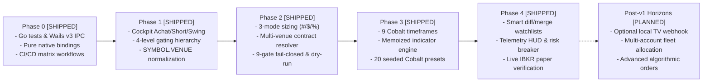

# Future Architecture & Rebuild Roadmap (`03_future_architecture`)

> **Navigation:** [Master Index](../00_index.md) | **Related:** [System Architecture](../02_present_state/system_architecture.md) · [Capability Matrix](../02_present_state/capability_matrix.md) · [Cobalt Indicators](../02_present_state/cobalt_indicators_and_courses.md) · [Cobalt Trading Universe](../02_present_state/cobalt_trading_universe.md) · [Decisions & Gaps](../04_evidence_and_sources/decisions_and_gaps.md)  
> **Status:** `Phases 0–4 Shipped & Verified at HEAD; Post-v1 Candidate Roadmap Active`

---

## 1. Purpose & Gap-Closure Scope

This roadmap documents the staged implementation and delivery trajectory of `tws_traderbot`. **Phases 0 through 4 have been fully shipped and verified** across Milestones 1 through 7, closing all legacy gaps and delivering the complete Cobalt "vibe trader" operator cockpit.

Future engineering horizons focus on post-v1 evolutionary capabilities (optional local TradingView alert receiver, multi-account fleet routing, and algorithmic order execution).

---

## 2. Phase 0 — Build Unblocking, Wails v3 IPC Cleanup & CI Alignment

**Status: Shipped & Verified in Milestone 1**

1. **Fixed Root Go Test Compilation:** Corrected `package main` declaration in `app_watchlist_test.go`, enabling clean passes for `go test ./...` and `go test -race ./...`.
2. **Clean-Break Wails v3 Bindings:** Regenerated native bindings exposing 41 Wails IPC methods (`42` Go `*App` methods including `ServiceStartup`) via `$Call.ByID` in `frontend/bindings/tws_traderbot/app.js`. Purged legacy Wails v2 `frontend/wailsjs/` directories.
3. **Eliminated Legacy REST Stubs:** Removed all `/api/v1/*` HTTP fallbacks and `(window as any).go` checks in `frontend/src/lib/api.ts`.
4. **CI/CD Workflow Matrix:** Configured GitHub Actions workflows (`ci.yml`, `release.yml`, `pages.yml`) for multi-platform builds and static release portal deployment.

---

## 3. Phase 1 — Cockpit-to-Engine Wiring, Multi-Workspace Seeding & Watchlist Sync

**Status: Shipped & Verified in Milestones 1 & 4**

1. **Seeded Cobalt Workspaces:** Seeded `Achat` (long), `Short` (short), and `Swing` (swing) workspaces in SQLite with strict 1/1 active strategy slot concurrency.
2. **Gating Hierarchy in Engine:** Implemented fail-closed checks across `global_enabled -> workspace.enabled -> slot.enabled -> item.enabled`.
3. **SYMBOL.VENUE Normalization:** Normalized all symbols to `SYMBOL.VENUE` via `backend/models/symbol.go`, eliminating all 8 exchange-stripped collisions.
4. **Regime Reference Classification:** Classified benchmark feeds (`CBLT - MARCHÉS`) as `regime_reference` to inform indicators without triggering orders.
5. **Smart Diff/Merge:** Watchlist refreshes update feeds while preserving local enabled states, sizing overrides, and Cobalt tiers.

---

## 4. Phase 2 — 3-Mode Position Sizing, Multi-Venue IBKR Routing & Execution Safety

**Status: Shipped & Verified in Milestone 2**

1. **Three-Mode Position Sizing:** Implemented `CalculatePositionSize` in `backend/bot/order.go` supporting fixed shares (`# shares`), fixed dollar notional (`$`), and portfolio percentage (`%`).
2. **Multi-Venue Contract Resolver:** Implemented `ResolveContract` in `backend/bot/resolver.go` handling US (`SMART/USD`), Canadian (`SMART/CAD`, TSE/VENTURE/PURE), and dot-class equities (`BRK B`, `CTC A`).
3. **9-Gate Fail-Closed Pipeline:** Implemented comprehensive execution safety checks in `backend/bot/engine.go` including session gating (`session.go`), master circuit breaker, and automated daily loss risk breaker.
4. **Atomic Sequencing & Brackets:** Synchronized atomic monotonic `NextValidID` from TWS socket and implemented OCA child brackets (`MKT` parent + OCA `LMT` + OCA `STP`).
5. **Dry-Run Ledger:** Enforced non-bypassable dry-run short-circuit logging simulated fills to SQLite `trade_ledger`.

---

## 5. Phase 3 — Cobalt TradingView Indicators, Multi-Timeframe Engine & Strategy Library UX

**Status: Shipped & Verified in Milestone 3**

1. **Unified Strategy Models:** Synchronized Go structs and Svelte schemas across all 9 Cobalt intervals (`1m`, `5m`, `15m`, `30m`, `1h`, `4h`, `1d`, `1w`, `1M`).
2. **Multi-Timeframe BarFrame Bundles:** Implemented hierarchical `symbol -> timeframe -> BarFrame` OHLCV bundles in `backend/strategy/barframe.go`.
3. **Memoized Indicator Engine:** Implemented thread-safe caching indicator pipeline in `backend/strategy/indicators.go` covering HA, RVOL, OBV, MACD, RSI, BB, Stoch, Alligator, Guppy, ATR, and RS vs SPX.
4. **Full Condition Coverage:** Evaluator supports all 7 condition types (`cross_above`, `cross_below`, `greater_than`, `less_than`, `slope_above`, `slope_below`, `within_range`).
5. **Pre-Seeded 20 Presets:** Pre-seeded all 13 Lesson 213 chart styles, 4 Screener 2.0 presets, and 3 Cours setups in SQLite `strategies` table.

---

## 6. Phase 4 — Live TWS Telemetry, Cobalt V2 Overhaul & Hardening

**Status: Shipped & Verified (Cobalt V2 Overhaul)**

1. **Live TWS Telemetry & `positions-detenues` Holdings Sync:** Dynamic account capture (`ManagedAccounts`), `AccountSummary`/`UpdateAccountValue` (`USD`/`CAD`/`BASE`), `Position`/`UpdatePortfolio`/`OpenOrder`/`OrderStatus`/`Pnl`, structured `BrokerAlerts` (`10089`/`504`), empty-seeded `positions-detenues` synced from `pos != 0` holdings, and race-hardened `third_party/ibapi`.
2. **Cockpit Stack, 4-Panel Monitoring & 3-Pane Strategy Workbench:** Locked HUD strip, pinned/reorderable Strategy Stack + `>= 78%` `SlideToArm`, 4-panel `/monitoring`, zero-scroll 3-pane `/strategy` workbench (`ActionFilter` validation), collapsible `Sidebar`, dark `<select>`, `F1`/`?` `HelpDrawer`, 3-track `OnboardingTour`, and `/manual`.
3. **Cobalt Brand & Wayland Packaging:** `cobalt_brand_and_ui_guide.md`, unified Cobalt emblem (`favicon.svg`, `appicon.png`, `icon.ico`, `site/favicon.svg`), Wayland `ApplicationID: ca.boostao.tws_traderbot`, `.desktop`/`hicolor` install in `Taskfile.yml`, and `site/dist/`.
4. **Bilingual Parity & Live IBKR Paper Gate:** `928` symmetric EN/FR keys in `translations.ts`, and read-only live socket telemetry + dry-run verification against `127.0.0.1:7497` (`DUO185814`) passing under `-race`.
5. **E2E, UI & Packaging Verification:** Full Go `-race` suite (backend + Tier 1–5 E2E), Playwright UI verification (`verify_v2_ui.mjs`), and Python packaging/hygiene/lockstep/i18n unit tests passing with zero failures.

---

## 7. Future Architecture Horizons (Post-v1)

Candidate architectural initiatives for post-v1 exploration:
1. **Local TradingView Alert / Webhook Bridge (`D-10`):** Optional localhost HTTP receiver to ingest discretionary TradingView alerts and route them through the 4-level safety gate.
2. **Multi-Account Institutional Fleet Routing:** Support concurrent execution across multiple sub-accounts with proportional allocation.
3. **Advanced Algorithmic Execution:** Volume-paced TWAP/VWAP execution slices and dynamic trailing stop-loss orders.
