# Architecture Decisions, Ambiguities & Gaps (`04_evidence_and_sources`)

> **Navigation:** [Master Index](../00_index.md) | **Related:** [Citations Index](./citations_index.md) · [Capability Matrix](../02_present_state/capability_matrix.md) · [System Architecture](../02_present_state/system_architecture.md) · [Roadmap](../03_future_architecture/roadmap.md)  
> **Status:** `Active`

---

## 1. Purpose & Governance Rule

Per operational knowledge governance, **no missing specification has been invented or assumed** across this repository. Every settled architectural choice, codebase discrepancy on `wails3` (`HEAD` `22beb38`), and open domain question across client design notes, Telegram coordination logs, `Méthode de travail 8.8`, `473` `/mon-compte/analyse` briefs, `36` Cobalt course video transcripts, `14` targeted keyframes, and Go/Svelte source files is registered below as a numbered **`D-XX`** entry.

```mermaid
flowchart LR
    subgraph Settled["Settled Architecture & Product Decisions"]
        D01["D-01: Local TWS Socket API<br/>(No VPS/Webhook in Release 1)"]
        D02["D-02: Native Go 1.26 + Wails v3 +<br/>Svelte 5 + SQLite (No Python/Pine)"]
        D06["D-06: Buy-First / Manual-Exit v1<br/>vs. Method 8.8 Immediate SL/TP"]
    end

    subgraph CodeGaps["Critical Codebase & Wiring Gaps (HEAD)"]
        D07["D-07: Strategy Schema Drift,<br/>9 Timeframes, Bar Dedup & Evaluator"]
        D09["D-09: Order Safety (NextValidId,<br/>Dry-Run, RTH/ETH, Telemetry & Pacing)"]
        D11["D-11: High-Scale UI, Sidebar Load &<br/>Bilingual (en/fr) Completeness"]
    end

    subgraph ClientConfirm["Open Decisions & Domain Confirmations"]
        D03["D-03: Workspaces (Achat/Short/Swing)<br/>& 1/1 Exclusive vs. 4-Slot Cap"]
        D04["D-04: TV Collisions, CBLT - MARCHÉS<br/>Regime Feeds, CAD Routing & Merge"]
        D05["D-05: 3-Mode Per-Ticker Sizing<br/>(# shares / $ / % Portfolio)"]
        D08["D-08: Cobalt Ratios PRO Thresholds,<br/>Locked Tiers & Data Feeds"]
        D10["D-10: Optional Phase 2 Webhook /<br/>Alert Bridge (SMS Deprecated)"]
        D12["D-12: IBKR Market Data (10089 / $2k),<br/>15m TSX Delay & FXCONV Readiness"]
    end

    Settled --> CodeGaps --> ClientConfirm
```

---

## 2. Master Decision & Ambiguity Register

### D-01: Local Desktop Execution via TWS Socket API (No VPS Order Routing in Release 1)
* **Status:** **Settled (`2026-04-28` Architecture Decision)**
* **Evidence:**
  * [`2026-04-28_Meeting-COBALT-AI-Algo-API_resume.pdf`](./citations_index.md#2-local-multimedia--client-communication-artifacts) (`L-02`), `NOTES.md` (`D-01`), and [`app.go`](../../app.go#L47-L78) (`127.0.0.1:7497`, `client_id: 1`).
  * `Trader / Client` and `Developer` rejected a remote VPS + TradingView webhook architecture for Release 1 in favor of running directly beside local IBKR TWS / IB Gateway to minimize latency, eliminate server maintenance, and preserve explicit local human arming.

---

### D-02: Native Go `1.26` + Wails v3 + Svelte 5 + SQLite Desktop Stack
* **Status:** **Settled (`commits 4c59c54`, `551bc78`, `22beb38`); Residual IPC & CI Cleanup Required**
* **Evidence & Settled Choices:**
  * [`MIGRATION_PLAN_GO_WAILS.md`](../../../MIGRATION_PLAN_GO_WAILS.md) and [`legacy_and_migration.md`](../01_history_and_evolution/legacy_and_migration.md) document the rewrite from the 3-process Python/FastAPI/`nautilus_trader`/DuckDB stack to a single native binary embedding Svelte 5 (`//go:embed all:frontend/dist`), pure-Go `modernc.org/sqlite`, and `github.com/scmhub/ibapi` (`v0.10.46`).
  * Python ML inference (`ml_models.py`) and Pine Script code generation (`pine_script.py`) were intentionally dropped (`commit 551bc78`).
* **Remaining Cleanup Gaps:**
  * [`frontend/src/lib/api.ts`](../../frontend/src/lib/api.ts) still gates 10 calls behind Wails v2 `(window as any).go` checks and routes 15 calls to defunct `/api/v1/*` HTTP endpoints.
  * Legacy `frontend/wailsjs/` files coexist with Wails v3 [`frontend/bindings/`](../../frontend/bindings/tws_traderbot/app.js), [`.github/workflows/release.yml`](../../.github/workflows/release.yml) still targets Wails v2 on `main`, and [`app_watchlist_test.go`](../../app_watchlist_test.go#L1-L2) has a duplicate `package main` preventing `go test .`.

---

### D-03: Cockpit Workspaces (`Achat`, `Short`, `Swing`) & Strategy Slot Cardinality
* **Severity / Status:** **High — Backend Wiring Missing & Slot Cardinality Ambiguous**
* **Evidence:**
  * `photo_3` (`bruno 1.m4a`) and hosted prototype screenshots (`photo_5`, `photo_8`, `NOTES.md`) define three operational tabs—**`Achat`** (`long`), **`Short`** (`short`), and **`Swing`** (`swing`)—each holding **4 strategy slots** (`1/4` active in `photo_5`), plus a global **Main Breaker** (`global_enabled`).
  * Current `App.GetCockpitState()` ([`app.go`](../../app.go#L139-L148)) seeds only a single `"Main Trading"` workspace (`id: "default"`, `kind: "long"`).
  * Current [`cockpit/+page.svelte`](../../frontend/src/routes/cockpit/+page.svelte#L52-L78) uses `buildExclusiveStrategyWorkspaces()` to limit active strategies globally to **1 exclusive slot (`0/1` or `1/1`)** (codified in root [`AGENTS.md`](../../AGENTS.md#L37-L39)).
  * `App.StartBot()` ([`app.go`](../../app.go#L209-L216)) passes an empty `&models.Strategy{}` and `Engine.EvaluateTick()` never reads `cockpit_state` or `watchlist_state`.
* **Decision Needed:**
  1. Wire `Achat` / `Short` / `Swing` workspace seeding and enforce `global_enabled -> workspace.enabled -> slot.enabled -> item.enabled` inside `bot.Engine`.
  2. Confirm with `Trader / Client` whether Release 1 enforces **1 active strategy globally (`1/1`)** across all workspaces or restores **up to 4 concurrent strategy slots per workspace (`1..4/4`)** as sketched in `photo_3` / `photo_5`.

---

### D-04: TradingView Shared Watchlist Disambiguation, `CBLT - MARCHÉS` Regime Feeds & Refresh Merge Policy
* **Severity / Status:** **High — 8 Symbol Collisions, Non-Orderable Regime Feeds & Hardcoded `STK/SMART/USD` Routing**
* **Evidence:**
  * Shared TradingView links are the canonical universe source while Telegram (`Cobalt Plateforme` / `CANAL-Cobalt` via `CobaltAdmin_bot`) acts solely as the distribution channel ([`cobalt_trading_universe.md`](../02_present_state/cobalt_trading_universe.md)).
  * Live inspection (`2026-11-16`) of **`✝️@ Cobalt- TELEGRAM`** (`209453826`: `687` symbols across `16` prefixes), **`⚾️@ Cobalt- Home Run`** (`111426240`: `123` symbols across `7` prefixes), and **`CBLT - MARCHÉS`** (`40576813`: `54` macro/regime benchmarks across `12` prefixes from `Lesson 197`) exposes concrete hazards against [`app_watchlist.go`](../../app_watchlist.go) and [`backend/bot/ibkr.go`](../../backend/bot/ibkr.go#L110-L115):
    1. **8 Exchange-Stripped Ticker Collisions (`209453826`):** Flattening `EXCHANGE:SYMBOL` into bare `WatchlistResponse.Symbols` collides on `BTCUSD` (`BINANCE`/`COINBASE`/`INDEX`), `ETHUSD` (`COINBASE`/`INDEX`), `FETH` (`TSX` vs. `CBOE`), `AQN` (`TSX` vs. `NYSE`), `CNR` (`NYSE` vs. `TSX`), `SPX` (`SP` vs. `TVC`), `NFLX` (`TSX` CDR vs. `NASDAQ`), and `MDA` (`TSX` vs. `NYSE`). Meanwhile `WatchlistItem.InstrumentID` (`SYMBOL.VENUE`) is never populated.
    2. **Hardcoded `STK / SMART / USD` vs. Multi-Asset / Regime Symbols:** Fails on Canadian listings (`TSX`, `TSXV`, `CSE` needing `CAD`), dot-class tickers (`NYSE:BRK.B`, `TSX:CTC.A`, `TSX:BBD.B`, `TSX:GIB.A`, `TSX:TCL.A` needing space notation in IBKR), TSX market indices (`TSX:TSX`, `TSX:TX60`, `TSX:TX40`, `TSX:TX20`, `TSX:JX`), non-orderable macro/yield/CFD/FX feeds (`TVC:VIX`, `TVC:SPX`, `SP:SPX`, `TVC:US02Y`–`US30Y`, `TVC:DXY`, `TVC:GOLD`, `TVC:SILVER`, `TVC:USOIL`, `CAPITALCOM:*`, `FX:*`, `FX_IDC:*`, `DJ:DJT`, `IC:STOXX50`), continuous futures (`CME_MINI:ES1!`, `NQ1!`), spot crypto (`COINBASE:*`, `BINANCE:*`, `KRAKEN:*`, `INDEX:*`), and European stocks (`LSE:AZN`, `GETTEX:CLV`, `MIL:ARN`).
    3. **Refresh Stub & Duplicate Hazard (`Lesson 206`):** `refreshWatchlistFeed()` in `api.ts` calls HTTP `POST /api/v1/watchlist/feed/refresh` instead of `ImportTradingViewWatchlist(feed.url)`. Meanwhile `Lesson 206` notes that TradingView `.txt` re-imports append duplicates unless manually deleted first—making in-app diff/merge essential.
* **Decision Needed:**
  1. Populate `InstrumentID` (`SYMBOL.VENUE`), route orderable US/Canadian equities via an explicit venue/currency/class resolver, and mark `40576813` / macro / yield / FX / index symbols as `regime_reference` (`market_data_only` — readable by filters, never orderable).
  2. Confirm feed-refresh merge policy: preserve local per-ticker `enabled` toggles (**suspend without deleting**), per-ticker sizing overrides, and optional `Méthode 8.8` categorization tags (`1-Blue Chip` / `2-Croissance` / `3-Spéculatif` / `4-Rejeté` / `($$$$)` owned holdings) across refreshes.

---

### D-05: Per-Ticker 3-Mode Position Sizing (`# shares`, `$` Notional, `%` Portfolio)
* **Severity / Status:** **High — Client Requirement Unimplemented in Go**
* **Evidence:**
  * On `2026-05-25` and `2026-05-28` (`messages.html` `#108`, `#110`, `#111`), `Trader / Client` specified per-ticker sizing controls inside the ticker list supporting **`# shares`** (highest priority), **`$` dollar amount**, and **`%` of portfolio** (e.g., `5%`).
  * Currently `Sidebar.svelte` only exposes global `Fixed Notional ($)` (`10000`), `strategy/+page.svelte` exposes `position_size_mode: "equal"`, and `IBWrapper.ExecuteAction()` ([`ibkr.go`](../../backend/bot/ibkr.go#L133)) hardcodes `TotalQuantity: ibapi.StringToDecimal("100")`.
* **Decision Needed:**
  * Confirm sizing precedence (per-ticker override > strategy/workspace default > sidebar global fallback) and fractional/minimum-share policy when `$` or `%` notional yields `< 1` share (skip order vs. round down `floor`).

---

### D-06: Buy-First / Manual-Exit Scope vs. `Méthode 8.8` Immediate Brackets & `Short` Semantics
* **Status:** **Settled for Release 1 (`bruno 1.m4a`, `NOTES.md`); Short-Entry, Order Types & Bracket Wiring Open**
* **Evidence:**
  * Release 1 (`bruno 1.m4a`, `NOTES.md`) prioritizes automated `BUY` entry while operators manage exits manually inside TWS (Hot Buttons / Brackets / Trailing Stops taught in `trader_ibkr`). By contrast, manual `Méthode de travail 8.8` (`Execution Steps A–E`) places immediate `Limit` + `Stop-Loss` exits at entry, supports `Market` / `Limit` / `Buy Stop` orders, and moves purchased holdings into `($$$$)`.
  * `Sidebar.svelte` persists `bracket_enabled` (`stop_loss_pct: 2`, `take_profit_pct: 4`), and `strategy/+page.svelte` exposes `sell` actions. However, `ibkr.go` (`actionMap`) checks uppercase `"BUY"`/`"SELL"` (never matching lowercase `models.ActionBuy` `"buy"` / `models.ActionSell` `"sell"`), ignores `bracket_enabled`, and lacks `"SHORT"`/`"COVER"` semantics.
  * `Lessons 212`/`229` establish that TradingView chart notes (`"achat... 10 à 174.94"`) are layout-scoped and vanish on exchange migrations or splits—confirming `tws_traderbot` needs an authoritative local SQLite execution ledger.
* **Decision Needed:**
  * Confirm whether the **`Short`** workspace (`kind: "short"`) should place live IBKR `SELL` short-opening orders in Release 1 (requiring account margin/locate readiness) or stay gated behind a confirmation toggle, and confirm whether `bracket_enabled` automatically attaches `STP` + `LMT` child orders to automated entries.

---

### D-07: Strategy Schema Drift (`frontend/` vs. `backend/models/`), 9 Cobalt Timeframes & Evaluator Gaps
* **Severity / Status:** **Critical — UI Rules Do Not Map 1:1 to Go Evaluation**
* **Evidence:**
  * [`strategy/+page.svelte`](../../frontend/src/routes/strategy/+page.svelte) serializes `crosses_above`, `crosses_below`, `per_ticker`, `length`, `params`, `component`, `symbol`, `initial_capital`, `max_positions`, `position_size_mode`, `position_size_value`, `tickers`, `priority`.
  * [`backend/models/strategy.go`](../../backend/models/strategy.go) defines `cross_above`, `cross_below`, `symbol`/`instrument`, `period`, `TimeframeUnit` (`1m`, `5m`, `15m`, `1h`, `1d` — missing `30m`, `4h`, `1w`, `1M` from Cobalt's **9 favorite intervals** in `Lesson 490` & `Méthode 8.8` `M/W -> D -> 30m..1m` sweep), and omits `params`, `component`, `symbol`, and sizing fields.
  * [`backend/strategy/evaluator.go`](../../backend/strategy/evaluator.go) handles only `cross_above`, `greater_than`, `slope_below` against static `"indicatorA"`/`"indicatorB"` keys, [`ibkr.go`](../../backend/bot/ibkr.go#L86-L90) generates `"SYM_<reqID>"` with only `Close`/`Open` (omitting `Volume`), and `Engine.EvaluateTick` has no bar-level trigger deduplication (`Once Per Bar` / `Once Only` from `Lesson 216`).
* **Decision Needed:**
  * Standardize a single canonical JSON contract across Go and TypeScript, add Go `ValidateStrategy()` and SQLite `strategy_library` CRUD bindings, implement `reqID -> (instrument_id, timeframe)` tracking with TWS pacing + `Volume`, enforce bar-level trigger deduplication, and support nested `symbol -> timeframe -> BarFrame` bundles alongside flat maps.

---

### D-08: Cobalt Indicators, `COBALT Ratios | PRO` Thresholds, Screener Presets & Locked Tiers
* **Severity / Status:** **Medium-High — Technical & Scope Boundary**
* **Evidence:**
  * [`cobalt_indicators_and_courses.md`](../02_present_state/cobalt_indicators_and_courses.md) extracts all 13 Lesson `213` templates, Lesson `212` `MODÈLE ANALYSE`, `4` official `Screener 2.0` presets (`US 52W High`, `Golden Cross 1D`, `Croisement 10-30 Haut/Bas`), and the exact **19-row `COBALT Ratios | PRO` (`v1.23` -> `v1.33`)** metrics & color thresholds (`P/E <= 15`, `EPS > 0`, `P/CF ~8`, `P/B <= 1..2`, `Graham Factor < 22.5`, `ROA/ROE/ROI >= 10%`, `ATR 14-session > 5%`, `Curr. Ratio <= 3.5`, `Debt/Equity <= 0.5`).
  * `backend/strategy/` currently implements only `SMA`, `EMA`, `CrossAbove`, and `Slope`. Missing indicators: `Volume + MA(100)`, `OBV`, `MACD (12, 26, 9)`, `RSI (14)`, `Bollinger Bands (20, 2)`, `Stochastic (15, 5, 5)`, `Williams Alligator (13/8, 8/5, 5/3)`, `Guppy MMA (W)` (requires 10 EMAs — `Plus` TradingView minimum), `Ticker/SPX (100)`, `Heikin-Ashi`, `ATR`/`ADR`, and fundamental ratios, plus `Méthode 8.8` Earnings proximity alerts.
  * Two TradingView modules (`view/294`, `Daytrading Intraséance`), `COBALT Ratios | PRO` PineScript source, and 80 modules in `Cours-01..06` remain gated behind `#abonnement-opportunites`.
* **Decisions Needed:**
  1. Confirm with `Trader / Client` which locked intraday (`Daytrading Intraséance`) or `COBALT Ratios | PRO` custom rules (if any) must be implemented beyond the unlocked Lesson `213` templates and `v1.23`/`v1.33` thresholds.
  2. Decide whether fundamental screens (`P/E`, `P/B`, `Graham`, `ROA/ROE/ROI`, `Div%`, `COBALT Ratios`) and Earnings-date filtering stay discretionary pre-screens inside TradingView (`Méthode 8.8` Steps `B`/`K` + `REGARD MATINAL`) or require IBKR `ReqFundamentalData` / external data integration.
  3. Confirm removal of the legacy `"ml_signal"` indicator entry from `strategy/+page.svelte` (since Python ML runtime was dropped per `D-02`).

---

### D-09: Order Execution Safety (`NextValidId`, Dry-Run Gate, `RTH`/`ETH`, Order Types & Telemetry)
* **Severity / Status:** **Critical — Execution-Safety & Observability Gap**
* **Evidence:**
  * `IBWrapper.ExecuteAction()` ([`ibkr.go`](../../backend/bot/ibkr.go#L130-L145)) increments `currentReqID` for `orderId` instead of tracking TWS `NextValidId`, has no internal `dryRun` flag preventing `PlaceOrder`, and hardcodes `MKT` `DAY` orders.
  * `Lesson 212` differentiates `RTH` vs. `ETH` on `< 1D` charts, and `Lesson 224` notes that **`MKT` orders fail outside RTH** (requiring `LMT` + `OutsideRth`). `Méthode 8.8` also uses `Limit` and `Buy Stop` entries alongside `Market`.
  * `GetRuntimeState()` returns only `{running: bool}` while [`monitoring/+page.svelte`](../../frontend/src/routes/monitoring/+page.svelte) expects `equity`, `daily_pnl`, `tws_connected`, `open_positions_count`, `recent_trades`, `dryRunBot()`, and `getDiagnostics()` (still HTTP stubs).
* **Decision Needed:**
  * Enforce atomic `NextValidId`, non-bypassable `dry_run` short-circuiting, SQLite `trade_ledger` persistence, and live TWS account/position/order callbacks; confirm Release 1 `MKT`/`LMT`/`STP` support and `useRTH` / `OutsideRth` defaults for intraday workspaces.

---

### D-10: TradingView Alert / Local Webhook Bridge vs. Native Go Evaluation (Email-to-SMS Deprecated)
* **Severity / Status:** **Low-Medium — Phase 2 Architecture Option**
* **Evidence:**
  * Early project chat (`messages.html`, March–April 2026) evaluated Pine Script webhooks before pivoting to local Go strategy evaluation (`D-01`, `D-02`).
  * `Lesson 216` explicitly notes that **Email-to-SMS gateways (`avtech.com`) are deprecated** across major Canadian carriers (Videotron/Rogers dropped; Telus residual), shifting TradingView notifications to mobile push/desktop toast and webhook/CSV alerts. Meanwhile `CANAL-Cobalt` (`CobaltAdmin_bot`, `09:00–13:30`) streams curated alerts over Telegram.
* **Decision Needed:**
  * Confirm whether Phase 2 should add an optional local webhook / alert receiver (for SRT trendlines, Weinstein Phase 2 breakouts, or `COBALT Ratios | PRO` signals routed through the Cockpit's 4-level `Main Breaker -> Workspace -> Slot -> Ticker` safety gate) or keep signal generation 100% inside Go `backend/strategy/`.

---

### D-11: High-Scale Watchlist UI, Sidebar Hydration & Bilingual (`en`/`fr`) Parity
* **Status:** **Partially Implemented — UX Polish & Bugfix Queue**
* **Evidence:**
  * `Trader / Client` requested larger, high-contrast buttons/text (`#84`), and `Advisor / Ops` raised grid scaling concerns (`#69`, suggesting `25/50/100/All` pagination for 500–687+ tickers).
  * `Sidebar.svelte:loadSidebarConfig()` is currently an empty function (`{}`), [`+page.ts`](../../frontend/src/routes/+page.ts) redirects `/` away from [`+page.svelte`](../../frontend/src/routes/+page.svelte), and newer labels in `monitoring/+page.svelte`, `+page.svelte`, and `"Filter tickers"` in `cockpit/+page.svelte` bypass [`translations.ts`](../../frontend/src/lib/i18n/translations.ts).

---

### D-12: IBKR TWS Configuration, Market-Data Subscriptions (`10089` / `15m` Delay) & `FXCONV` Readiness
* **Status:** **Operational Prerequisite (External to Binary)**
* **Evidence:**
  * [`TWS_SETUP_GUIDE.md`](../../../TWS_SETUP_GUIDE.md), `Cours-02` (`Lesson 299` noting `$2,000 USD` funding requirement for live market data), `Lesson 209`/`386` (warning that free feeds suffer `CBOE-BZX` candle distortion and **`15m` TSX/TSXV delays**, corrupting `ADR`/`ATR`), and the 57-item `trader_ibkr` curriculum (`API Automation & Software Disclosure`, `Enable ActiveX and Socket Clients`, unchecking `Read-Only API`, `FXCONV` vs. speculative FX pairs for `CAD`/`USD` conversion) document non-code broker prerequisites.
* **Decision Needed:**
  * Surface explicit `/monitoring` health banners and bilingual `/manual` checklists when TWS returns `504` (not connected), `10089` (missing real-time market data subscription), or read-only/currency conversion rejections.
