# Architecture Decisions, Ambiguities & Gaps (`04_evidence_and_sources`)

> **Navigation:** [Master Index](../00_index.md) | **Related:** [Citations Index](./citations_index.md) · [Capability Matrix](../02_present_state/capability_matrix.md) · [System Architecture](../02_present_state/system_architecture.md) · [Roadmap](../03_future_architecture/roadmap.md)  
> **Status:** `Active`

---

## 1. Purpose & Governance Rule

Per operational knowledge governance, **no missing specification has been invented or assumed** across this repository. Every settled architectural choice, codebase discrepancy on `wails3` (`HEAD` — Cobalt V2 Overhaul), and open domain question across client design notes, Telegram coordination logs, `Méthode de travail 8.8`, `473` `/mon-compte/analyse` briefs, `36` Cobalt course video transcripts, `14` targeted keyframes, and Go/Svelte source files is registered below as a numbered **`D-XX`** entry.

```mermaid
flowchart LR
    subgraph SettledArch["Settled Architecture & Desktop Platform"]
        D01["D-01: Local TWS Socket (127.0.0.1:7497)"]
        D02["D-02: Native Go 1.26 + Wails v3 (41 IPC) + Svelte 5"]
        D10["D-10: Local Go Strategy Evaluation (Webhook Deferred)"]
        D17["D-17: Canonical Cobalt Brand & Wayland Packaging"]
    end

    subgraph SettledExecution["Settled Cockpit, Watchlists & Routing Invariants"]
        D03["D-03: 3 Workspaces (Achat/Short/Swing) & 1/1 Concurrency"]
        D04["D-04: SYMBOL.VENUE, 0 Collisions & Smart Diff/Merge"]
        D05["D-05: 3-Mode Sizing (# shares / $ / % portfolio)"]
        D06["D-06: Buy-First Entry & OCA Child Brackets (CreateBracketOrders)"]
        D13["D-13: Live TWS Telemetry & Empty positions-detenues Sync"]
        D15["D-15: Pinned/Ordered Strategy Stack & >=78% SlideToArm"]
    end

    subgraph SettledSafety["Settled Engine, Presets, UI & Verification"]
        D07["D-07: 9 Cobalt Timeframes & BarFrameBundle Engine"]
        D08["D-08: 11+ Indicators & 20 Seeded Cobalt Presets"]
        D09["D-09: 9-Gate Fail-Closed, NextValidID & Dry-Run Ledger"]
        D11["D-11: Uni Noir Ticker Rows, Hydration & 100% i18n Parity"]
        D12["D-12: Diagnostic Telemetry, Circuit Breaker & Safety HUD"]
        D14["D-14: Collapsible Sidebar, Single Badge & Dark Select"]
        D16["D-16: 4-Panel Trader Monitoring, NY/Toronto & BrokerAlerts"]
        D18["D-18: 3-Pane Strategy Workbench, F1 Help & 3-Track Tour"]
    end

    SettledArch --- SettledExecution --- SettledSafety
```

---

## 2. Master Decision & Ambiguity Register

### D-01: Local Desktop Execution via TWS Socket API (No VPS Order Routing in Release 1)
* **Status:** **Settled & Verified (`HEAD`)**
* **Evidence & Verification:**
  * Architecture decision confirmed running directly beside local IBKR TWS / IB Gateway (`127.0.0.1:7497`, `client_id: 1`).
  * Live paper smoke verification executed against `127.0.0.1:7497` successfully negotiated protocol handshake with `serverVersion 226`, `<ConnectAck>`, and dynamic account capture via `ManagedAccounts` (e.g., Paper account `DUO185814` persisted to `config.ib.account`).
  * `github.com/scmhub/ibapi@v0.10.50` is locally patched under `third_party/ibapi` (`go.mod` `replace`) with `watchDone`/CAS synchronization in `EClient.Disconnect()` and atomic `EClient.IsConnected()` so live TWS reconnect/disconnect cycles pass `go test -race` cleanly.

---

### D-02: Native Go `1.26` + Wails v3 + Svelte 5 + SQLite Desktop Stack
* **Status:** **Settled & Completed (`HEAD`)**
* **Evidence & Settled Choices:**
  * Clean-break implementation in Go `1.26` and Wails v3 embedding Svelte 5 (`//go:embed all:frontend/dist`), pure-Go `modernc.org/sqlite` in WAL mode, and `github.com/scmhub/ibapi`.
  * All 15 legacy `/api/v1/*` HTTP stubs, `(window as any).go` guards, and dead `frontend/wailsjs/` directories have been completely purged from `frontend/src/lib/api.ts`.
  * App exposes 41 native Wails v3 IPC methods via `$Call.ByID` (`42` Go `*App` methods including `ServiceStartup`).

---

### D-03: Cockpit Workspaces (`Achat`, `Short`, `Swing`) & Strategy Slot Cardinality
* **Status:** **Settled & Implemented (`HEAD`)**
* **Evidence & Invariants:**
  * 3 operational workspaces (**`Achat`**, **`Short`**, **`Swing`**) pre-seeded in SQLite and rendered in Cockpit UI.
  * Invariant enforced: strict **`1/1` active strategy slot concurrency** across all workspaces, validated in UI (`buildExclusiveStrategyWorkspaces`) and fail-closed in `bot.Engine.CanExecute` (Gate 5).
  * 4-level execution hierarchy enforced: `global_enabled -> workspace.enabled -> slot.enabled -> item.enabled`.

---

### D-04: TradingView Shared Watchlist Disambiguation, `SYMBOL.VENUE`, Regime Feeds & Diff Merge
* **Status:** **Settled & Implemented (`HEAD`)**
* **Evidence & Invariants:**
  * All tickers normalized to canonical `SYMBOL.VENUE` via `backend/models/symbol.go`, eliminating all 8 exchange-stripped collisions.
  * Macro, yield, FX, and benchmark index feeds (`CBLT - MARCHÉS`) classified as `regime_reference` / `market_data_only`, informing indicators while blocked from order creation (Gate 7).
  * Smart diff/merge preserves local per-ticker `enabled` toggles, sizing overrides, and Cobalt tiering across watchlist refreshes.

---

### D-05: Per-Ticker 3-Mode Position Sizing (`# shares`, `$` Notional, `%` Portfolio)
* **Status:** **Settled & Implemented (`HEAD`)**
* **Evidence & Invariants:**
  * Implemented in `backend/bot/order.go` (`CalculatePositionSize`): evaluates `# shares` (top priority), fixed dollar notional `$`, or `% portfolio` equity.
  * Supported in relational `watchlist_items` schema (`size_mode`, `size_value`) and Cockpit single-line ticker rows.

---

### D-06: Buy-First / Manual-Exit Scope vs. `Méthode 8.8` Immediate Brackets & `Short` Semantics
* **Status:** **Settled & Implemented (`HEAD`)**
* **Evidence & Invariants:**
  * Release 1 supports automated buy-first entry workflow with optional automated OCA child bracket orders (`CreateBracketOrders`: `MKT` parent + OCA `LMT` profit target + OCA `STP` stop loss).
  * All trade actions and simulated dry-run fills are auditable via SQLite `trade_ledger`.

---

### D-07: Unified Strategy Schema, 9 Cobalt Timeframes & BarFrame Pipeline
* **Status:** **Settled & Implemented (`HEAD`)**
* **Evidence & Invariants:**
  * Canonical Go structs and TypeScript interfaces synchronized across `strategy.go`.
  * Support for all 9 Cobalt intervals (`1m`, `5m`, `15m`, `30m`, `1h`, `4h`, `1d`, `1w`, `1M`) via `BarFrameBundle` (`symbol -> timeframe -> BarFrame`).
  * Evaluator supports all 7 condition types, with bar-level trigger deduplication and cooldowns.

---

### D-08: Cobalt Indicators, 20 Presets & Screener 2.0 Catalog
* **Status:** **Settled & Implemented (`HEAD`)**
* **Evidence & Invariants:**
  * Thread-safe memoized indicator engine in `backend/strategy/indicators.go` (HA, RVOL, OBV, MACD, RSI, BB, Stoch, Alligator, Guppy, ATR, RS vs SPX) with division-by-zero resilience.
  * All 20 Cobalt presets (13 chart styles, 4 Screener 2.0 presets, 3 Cours setups) pre-seeded in SQLite `strategies` table.
  * `"ml_signal"` is deprecated in execution and unseeded across all 20 presets (`backend/strategy/catalog.go`), while `IndicatorMLSignal` remains in `backend/models/strategy.go` and the Rule Inspector dropdown strictly for schema backward-compatibility (falling back to `close` series).

---

### D-09: Order Execution Safety, Atomic NextValidId, Dry-Run Gate & Audit Ledger
* **Status:** **Settled & Implemented (`HEAD`)**
* **Evidence & Invariants:**
  * 9-gate fail-closed pipeline in `backend/bot/engine.go` validating all safety invariants before order submission.
  * Atomic `NextValidID` synchronization via `atomic.Int64` in `order.go`.
  * Non-bypassable dry-run short-circuit strictly preventing live TWS order routing while recording simulated fills to SQLite `trade_ledger`.
  * Multi-venue contract resolver for US (`SMART/USD`), Canadian (`SMART/CAD`), and dot-class equities (`BRK B`, `CTC A`).
  * Session gating (`session.go`) blocking `MKT` orders during ETH.

---

### D-10: TradingView Alert / Local Webhook Bridge vs. Native Go Evaluation
* **Status:** **Settled for Release 1 (`HEAD`)**
* **Evidence & Invariants:**
  * Release 1 executes 100% locally in Go against TWS market data. Email-to-SMS gateways deprecated.
  * Optional local webhook / alert bridge architecture deferred to post-v1 candidate roadmap.

---

### D-11: High-Scale Watchlist UI, Sidebar Hydration & Bilingual (`en`/`fr`) Parity
* **Status:** **Settled & Implemented (`HEAD`)**
* **Evidence & Invariants:**
  * High-density Uni Noir single-line ticker rows with inline venue, tier, holding badges, and sizing controls.
  * Sidebar automatically hydrates settings from SQLite `system_config` on mount via `GetConfig()`.
  * 100% bilingual parity across English and French in `translations.ts` with zero prohibited jargon, enforced by `check-i18n-parity.py`.

---

### D-12: IBKR TWS Configuration, Diagnostic Telemetry & Circuit Breaker
* **Status:** **Settled & Implemented (`HEAD`)**
* **Evidence & Invariants:**
  * Telemetry HUD in Cockpit and `/monitoring` surfaces live equity, daily PnL, loss limit, circuit breaker state, and heartbeat.
  * Automated daily loss risk breaker halts automated entry orders upon limit breach and requires manual arming via `ResetCircuitBreaker()`.
  * Error status codes (504, 10089) surfaced cleanly with informative diagnostics.

---

### D-13: Live IBKR TWS Telemetry Ingestion & Non-Seeded `positions-detenues`
* **Status:** **Settled & Verified (`HEAD`)**
* **Evidence & Invariants:**
  * `IBWrapper` ingests `ManagedAccounts`, `AccountSummary`, `UpdateAccountValue` (`CashBalance` `USD`/`CAD`/`BASE`), `Position`, `PositionEnd`, `UpdatePortfolio`, `OpenOrder`, `OrderStatus`, and `Pnl`.
  * `Engine` defaults `Equity` to `0.0` when TWS has not reported (no `100000.0` or hardcoded account stubs), and `db.Connect` uses `SetMaxOpenConns(1)` to serialize concurrent telemetry/watchlist SQLite writes cleanly.
  * `positions-detenues` (`"Positions détenues ($$$$)"`) seeds empty (`Symbols: []`); `db.SyncLivePositions()` reconciles `is_holding` (`$$$$`) across all watchlists and replaces `positions-detenues` strictly with live `pos != 0` TWS holdings.

---

### D-14: Collapsible Sidebar, Single Authoritative Status Badge & Global Dark `<select>`
* **Status:** **Settled & Verified (`HEAD`)**
* **Evidence & Invariants:**
  * Global `<select>`/`<option>` rules in `frontend/src/app.css` enforce `color-scheme: dark`, `appearance: none`, `#0b1320` surface, and custom SVG chevrons across GTK4/WebKitGTK and Chromium.
  * `Sidebar.svelte` owns the single authoritative `data-testid="status-badge"` (`TWS Connected` + `RUNNING`/`ARMED`/`STOPPED`) and auto-collapses Broker (`Connexion TWS`) & Risk (`Gestion du portefeuille & Risque`) into 1-line summary chips when connected.

---

### D-15: Cockpit Pinned/Ordered Strategy Stack & `>= 78%` `SlideToArm`
* **Status:** **Settled & Verified (`HEAD`)**
* **Evidence & Invariants:**
  * `strategies` table stores `pinned` and `sort_order` (with idempotent SQLite migration), sorted `(pinned DESC, sort_order ASC, name ASC)` and mutated via `ToggleStrategyPin` / `MoveStrategyOrder`.
  * `/cockpit` replaces the strategy `<select>` dropdown with a `1/1` Active Strategy Card and Strategy Stack featuring `>= 78%` (`MIN_DRAG_DISTANCE_PX = 16`) `SlideToArm.svelte` hot-swap (`pointercancel`/blur abort-safe) and locked 3-row `.cockpit-shell` + fixed single-bar `.cockpit-hud-strip`.

---

### D-16: Trader-Centric 4-Panel `/monitoring`, `NY/Toronto` Session Status & `BrokerAlerts`
* **Status:** **Settled & Verified (`HEAD`)**
* **Evidence & Invariants:**
  * `/monitoring` and `app_diagnostics.go` purge developer noise (`tws_traderbot.sqlite`, `local_sqlite`, `desktop_local`, `tws_traderbot.log`) and organize telemetry into 4 trader panels: Portfolio & `FXCONV` Currency Readiness (`USD`/`CAD`/`BASE` + breaker headroom), Live Open Positions (`$$$$`), Working Orders & `DryRunBot` Scanner, and Execution & `NY/Toronto` Session / `BrokerAlerts` (`10089`/`504`) Ledger.
  * `BuildRuntimeState`, `BuildDiagnostics`, and `RunDryRun` resolve the active Cockpit strategy accurately even when paused/stopped.

---

### D-17: Canonical Cobalt Brand Identity, Two-Tier Emblem & Linux Wayland Packaging
* **Status:** **Settled & Verified (`HEAD`)**
* **Evidence & Invariants:**
  * `okf/02_present_state/cobalt_brand_and_ui_guide.md` harmonizes `https://www.cobaltinvestissements.com/` (`#263c8a`, `#0e0c28`, `#faa031`, `#edc44e`) with `Uni Noir` (`#05070b`/`#0b111e`) and `IoskeleyMono`.
  * Unified Cobalt geometric emblem applied across `frontend/src/lib/assets/favicon.svg`, `Sidebar.svelte`, `build/appicon.png`, `build/windows/icon.ico`, and `site/favicon.svg` (`site/dist/`).
  * `main.go`, `build/config.yml`, `build/linux/ca.boostao.tws_traderbot.desktop`, and `Taskfile.yml` (`linux:install-desktop`) configure Wayland `ApplicationID: ca.boostao.tws_traderbot` and `hicolor` icon installation.

---

### D-18: 3-Pane Zero-Scroll Strategy Workbench, `F1` Help Drawer & 3-Track Onboarding Tour
* **Status:** **Settled & Verified (`HEAD`)**
* **Evidence & Invariants:**
  * `/strategy` renders a fixed-viewport 3-pane workbench (searchable/workspace-filtered Preset Stack, `Filtres Macro → Entrées → Sorties` pipeline, 2-col Rule Inspector across 22 indicators & 9 timeframes, slide-over JSON drawer), with `ValidateStrategy` allowing `ActionFilter` alongside `ActionBuy`/`ActionSell`.
  * `HelpDrawer.svelte` (`F1`/`?`) and 3-track `OnboardingTour.svelte` (`localStorage` key `cobalt_onboarding_state`, 1-click launchers on `/manual`) provide in-cockpit guidance while reactive `$language` switching (`928` EN/FR keys) preserves unsaved route state.

---

### D-19: Async Telemetry Journaling & JSON Digest Pipeline
* **Status:** **Settled & Implemented**
* **Evidence & Invariants:**
  * Async journal writer (`backend/bot/journal.go`) processes state changes/order events in a buffered queue to avoid Wails IPC flooding.
  * `GenerateJSONDigest` (`backend/bot/reporter.go`) summarizes journaled events for operational audits.

---

## 3. Known Gaps & Ambiguities

| ID | Description | Status | Assignment |
|---|---|---|---|
| **G-01** | Optional local TradingView webhook bridge (`D-10`) | `Planned` | Engineering |
| **G-02** | Multi-account institutional fleet routing | `Planned` | Engineering |
| **G-03** | Advanced algorithmic execution (TWAP/VWAP) | `Planned` | Engineering |

