# Architecture Decisions, Ambiguities & Gaps (`04_evidence_and_sources`)

> **Navigation:** [Master Index](../00_index.md) | **Related:** [Citations Index](./citations_index.md) · [Capability Matrix](../02_present_state/capability_matrix.md) · [System Architecture](../02_present_state/system_architecture.md) · [Roadmap](../03_future_architecture/roadmap.md)  
> **Status:** `Active`

---

## 1. Purpose & Governance Rule

Per operational knowledge governance, **no missing specification has been invented or assumed** across this repository. Every settled architectural choice, codebase discrepancy on `wails3` (`HEAD` `22beb38`), and open domain question across client design notes, Telegram coordination logs, `Méthode de travail 8.8`, `473` `/mon-compte/analyse` briefs, `36` Cobalt course video transcripts, `14` targeted keyframes, and Go/Svelte source files is registered below as a numbered **`D-XX`** entry.

```mermaid
flowchart LR
    subgraph SettledArch["Settled Architecture & Desktop Platform"]
        D01["D-01: Local TWS Socket (127.0.0.1:7497)"]
        D02["D-02: Native Go 1.26 + Wails v3 + Svelte 5 + SQLite"]
        D10["D-10: Local Go Strategy Evaluation (Webhook Deferred)"]
    end

    subgraph SettledExecution["Settled Cockpit, Watchlists & Routing Invariants"]
        D03["D-03: 3 Workspaces (Achat/Short/Swing) & 1/1 Concurrency"]
        D04["D-04: SYMBOL.VENUE, 0 Collisions & Smart Diff/Merge"]
        D05["D-05: 3-Mode Sizing (# shares / $ / % portfolio)"]
        D06["D-06: Buy-First Entry & OCA Child Brackets (STP+LMT)"]
    end

    subgraph SettledSafety["Settled Engine, Presets & Verification"]
        D07["D-07: 9 Cobalt Timeframes & BarFrameBundle Engine"]
        D08["D-08: 11+ Indicators & 20 Seeded Cobalt Presets"]
        D09["D-09: 9-Gate Fail-Closed, NextValidID & Dry-Run Ledger"]
        D11["D-11: Uni Noir Ticker Rows, Hydration & 100% i18n Parity"]
        D12["D-12: Diagnostic Telemetry, Circuit Breaker & Safety HUD"]
    end

    SettledArch --- SettledExecution --- SettledSafety
```

---

## 2. Master Decision & Ambiguity Register

### D-01: Local Desktop Execution via TWS Socket API (No VPS Order Routing in Release 1)
* **Status:** **Settled & Verified (`HEAD`)**
* **Evidence & Verification:**
  * Architecture decision confirmed running directly beside local IBKR TWS / IB Gateway (`127.0.0.1:7497`, `client_id: 1`).
  * Live paper smoke verification executed against `127.0.0.1:7497` successfully negotiated protocol handshake with `serverVersion 226`, `<ConnectAck>`, and account `DUO185814`.

---

### D-02: Native Go `1.26` + Wails v3 + Svelte 5 + SQLite Desktop Stack
* **Status:** **Settled & Completed (`HEAD`)**
* **Evidence & Settled Choices:**
  * Clean-break implementation in Go `1.26` and Wails v3 embedding Svelte 5 (`//go:embed all:frontend/dist`), pure-Go `modernc.org/sqlite` in WAL mode, and `github.com/scmhub/ibapi`.
  * All 15 legacy `/api/v1/*` HTTP stubs, `(window as any).go` guards, and dead `frontend/wailsjs/` directories have been completely purged from `frontend/src/lib/api.ts`.
  * App exposes 32 native Wails v3 IPC methods via `$Call.ByID`.

---

### D-03: Cockpit Workspaces (`Achat`, `Short`, `Swing`) & Strategy Slot Cardinality
* **Status:** **Settled & Implemented (`HEAD`)**
* **Evidence & Invariants:**
  * 3 operational workspaces (**`Achat`**, **`Short`**, **`Swing`**) pre-seeded in SQLite and rendered in Cockpit UI.
  * Invariant enforced: strict **`1/1` active strategy slot concurrency** across all workspaces, validated in UI (`buildExclusiveStrategyWorkspaces`) and fail-closed in `bot.Engine.CanExecute` (Gate 5).
  * 4-level execution hierarchy enforced: `global_enabled -> workspace.enabled -> slot.enabled -> item.enabled`.

---

### D-04: TradingView Shared Watchlist Disambiguation, `SYMBOL.VENUE`, Regime Feeds & Diff Merge
* **Status:** **Settled & Implemented (`HEAD`)**
* **Evidence & Invariants:**
  * All tickers normalized to canonical `SYMBOL.VENUE` via `backend/models/symbol.go`, eliminating all 8 exchange-stripped collisions.
  * Macro, yield, FX, and benchmark index feeds (`CBLT - MARCHÉS`) classified as `regime_reference` / `market_data_only`, informing indicators while blocked from order creation (Gate 7).
  * Smart diff/merge preserves local per-ticker `enabled` toggles, sizing overrides, and Cobalt tiering across watchlist refreshes.

---

### D-05: Per-Ticker 3-Mode Position Sizing (`# shares`, `$` Notional, `%` Portfolio)
* **Status:** **Settled & Implemented (`HEAD`)**
* **Evidence & Invariants:**
  * Implemented in `backend/bot/order.go` (`CalculatePositionSize`): evaluates `# shares` (top priority), fixed dollar notional `$`, or `% portfolio` equity.
  * Supported in relational `watchlist_items` schema (`size_mode`, `size_value`) and Cockpit single-line ticker rows.

---

### D-06: Buy-First / Manual-Exit Scope vs. `Méthode 8.8` Immediate Brackets & `Short` Semantics
* **Status:** **Settled & Implemented (`HEAD`)**
* **Evidence & Invariants:**
  * Release 1 supports automated buy-first entry workflow with optional automated OCA child bracket orders (`CreateBracketOrderPair`: `MKT` parent + OCA `LMT` profit target + OCA `STP` stop loss).
  * All trade actions and simulated dry-run fills are auditable via SQLite `trade_ledger`.

---

### D-07: Unified Strategy Schema, 9 Cobalt Timeframes & BarFrame Pipeline
* **Status:** **Settled & Implemented (`HEAD`)**
* **Evidence & Invariants:**
  * Canonical Go structs and TypeScript interfaces synchronized across `strategy.go`.
  * Support for all 9 Cobalt intervals (`1m`, `5m`, `15m`, `30m`, `1h`, `4h`, `1d`, `1w`, `1M`) via `BarFrameBundle` (`symbol -> timeframe -> BarFrame`).
  * Evaluator supports all 7 condition types, with bar-level trigger deduplication and cooldowns.

---

### D-08: Cobalt Indicators, 20 Presets & Screener 2.0 Catalog
* **Status:** **Settled & Implemented (`HEAD`)**
* **Evidence & Invariants:**
  * Thread-safe memoized indicator engine in `backend/strategy/indicators.go` (HA, RVOL, OBV, MACD, RSI, BB, Stoch, Alligator, Guppy, ATR, RS vs SPX) with division-by-zero resilience.
  * All 20 Cobalt presets (13 chart styles, 4 Screener 2.0 presets, 3 Cours setups) pre-seeded in SQLite `strategies` table.
  * Stale `"ml_signal"` indicator eliminated from codebase.

---

### D-09: Order Execution Safety, Atomic NextValidId, Dry-Run Gate & Audit Ledger
* **Status:** **Settled & Implemented (`HEAD`)**
* **Evidence & Invariants:**
  * 9-gate fail-closed pipeline in `backend/bot/engine.go` validating all safety invariants before order submission.
  * Atomic `NextValidID` synchronization via `atomic.Int64` in `order.go`.
  * Non-bypassable dry-run short-circuit strictly preventing live TWS order routing while recording simulated fills to SQLite `trade_ledger`.
  * Multi-venue contract resolver for US (`SMART/USD`), Canadian (`SMART/CAD`), and dot-class equities (`BRK B`, `CTC A`).
  * Session gating (`session.go`) blocking `MKT` orders during ETH.

---

### D-10: TradingView Alert / Local Webhook Bridge vs. Native Go Evaluation
* **Status:** **Settled for Release 1 (`HEAD`)**
* **Evidence & Invariants:**
  * Release 1 executes 100% locally in Go against TWS market data. Email-to-SMS gateways deprecated.
  * Optional local webhook / alert bridge architecture deferred to post-v1 candidate roadmap.

---

### D-11: High-Scale Watchlist UI, Sidebar Hydration & Bilingual (`en`/`fr`) Parity
* **Status:** **Settled & Implemented (`HEAD`)**
* **Evidence & Invariants:**
  * High-density Uni Noir single-line ticker rows with inline venue, tier, holding badges, and sizing controls.
  * Sidebar automatically hydrates settings from SQLite `system_config` on mount via `GetConfig()`.
  * 100% bilingual parity across English and French in `translations.ts` with zero prohibited jargon, enforced by `check-i18n-parity.py`.

---

### D-12: IBKR TWS Configuration, Diagnostic Telemetry & Circuit Breaker
* **Status:** **Settled & Implemented (`HEAD`)**
* **Evidence & Invariants:**
  * Telemetry HUD in Cockpit and `/monitoring` surfaces live equity, daily PnL, loss limit, circuit breaker state, and heartbeat.
  * Automated daily loss risk breaker halts automated entry orders upon limit breach and requires manual arming via `ResetCircuitBreaker()`.
  * Error status codes (504, 10089) surfaced cleanly with informative diagnostics.
